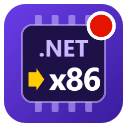
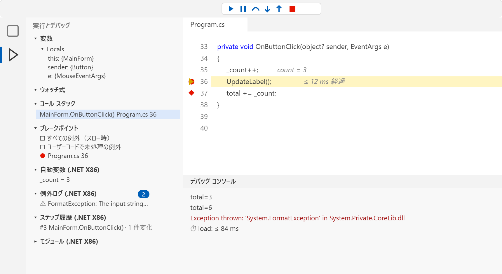
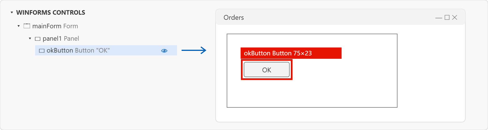
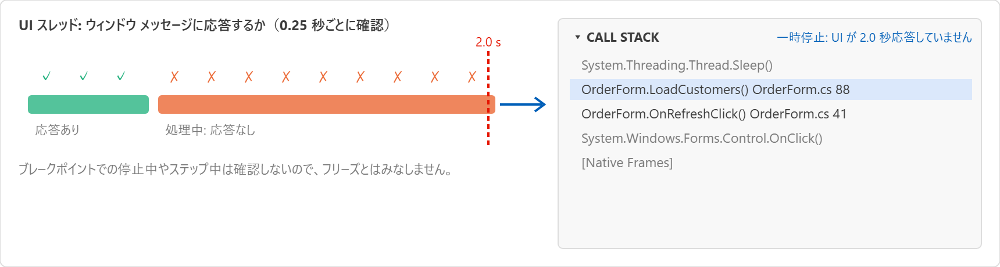
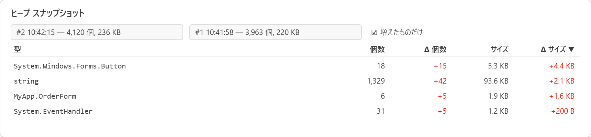

<p align="center"></p>

<h1 align="center">.NET x86 Debugger</h1>

<p align="center"><b>32bit (x86) の .NET / .NET Framework アプリを、WinForms も含めて Visual Studio Code でデバッグします。</b></p>

<p align="center"><a href="https://github.com/takahino/vscode-dotnet-x86-debugger/releases"></a> <a href="https://github.com/takahino/vscode-dotnet-x86-debugger/actions/workflows/ci.yml"></a> <a href="LICENSE"></a></p>

<p align="center"><a href="README.md">English</a> · <a href="https://takahino.github.io/vscode-dotnet-x86-debugger/usage.jp.html">図解ガイド</a> · <a href="CHANGELOG.md">変更履歴</a></p>



C# 拡張のデバッガー (vsdbg) は x64 / arm64 版しかないため、`<PlatformTarget>x86</PlatformTarget>` でビルドしたアプリは
VS Code でデバッグできません。この拡張は、x86 のための自前のデバッグ エンジン **dotnet-x86dbg**（Rust、x86 と x64）を同梱し、
Visual Studio にある機能を中継役で補います。Visual Studio にもない機能もいくつかあります。デバッガー自身は .NET を使わないので、
.NET Framework のアプリは .NET を入れていない Windows でもデバッグできます。

## クイック スタート

1. [dotnet.microsoft.com](https://dotnet.microsoft.com/download/dotnet) から **.NET Desktop Runtime x86**（8 以降）と .NET SDK をインストールします。
2. [Releases](https://github.com/takahino/vscode-dotnet-x86-debugger/releases) から `.vsix` をダウンロードし、**Extensions: Install from VSIX...** で拡張機能をインストールします。
3. プロジェクトのフォルダーを開き、**.NET x86: はじめに** を実行します。**F5** を押すだけでも、`.csproj` から launch.json とビルド タスクが作られます。

**.NET x86: 環境を確認** で足りないものがわかり、プロジェクト ファイル（x86・Portable PDB）もボタン 1 つで直せます。

## 特長

- **Visual Studio と同じデバッグ** — 例外設定、並列スタックとスレッドの凍結、次のステートメントの設定、Step Into Specific、
  戻り値、オブジェクト ID、DebuggerDisplay、PerfTips、メモリ / CPU グラフ、ヒープ スナップショット。
- **さらにその先（★）** — 呼び出し元で絞るブレークポイント、UI フリーズの自動検知、スロー時のローカル変数まで残る例外ログ、
  停止状態からの単体テスト生成、止めずに記録する値の推移と区間の時間計測、セッションの報告書。
- **WinForms のための機能** — 停止中のコントロール ツリー、画面上での強調表示、コントロールのイベントで停止、停止中のプロパティ変更。
- **自分のコード以外にも入れる** — Source Link、シンボル サーバー、シンボルのないアセンブリを逆コンパイルしてステップ イン。
- **.NET 5 以降と .NET Framework 4.x**、x86 と x64（AnyCPU も）、自己完結と単一ファイルの発行。起動・アタッチ（プロセス名を指定して起動を待つことも）に対応。

| | |
|---|---|
|  |  |



## 機能一覧

★ は Visual Studio に無い機能です。すべての機能を、図とユースケースつきで [図解ガイド](https://takahino.github.io/vscode-dotnet-x86-debugger/usage.jp.html) にまとめています。

| 機能 | 内容 | 場所 |
|---|---|---|
| **止めたいところで止める** | | |
| [条件・ヒットカウント・ログポイント](#ヒットカウント付きブレークポイント) | 条件や n 回目で停止、止めずにログ出力 | 行番号の左を右クリック |
| [一時・依存・値の変化ブレークポイント](#一時依存値の変化呼び出し元のブレークポイント) | 1 回だけ／別の場所の後だけ／値が変わったときだけ停止 | エディターの右クリック |
| [呼び出し元で絞るブレークポイント](#一時依存値の変化呼び出し元のブレークポイント) ★ | 特定のメソッドから呼ばれたときだけ停止 | エディターの右クリック |
| [値が変わったら停止](#値が変わったら停止) | フィールドや変数を変更した行で停止 | 変数ビューの右クリック |
| [例外ブレークポイントと例外設定](#例外設定) | スロー時・未処理時に停止（型で絞り込み、または一覧でチェック） | ブレークポイント／例外設定ビュー |
| [UI フリーズの自動検知](#ui-フリーズの自動検知) ★ | UI スレッドが止まっている場所で一時停止 | 自動 |
| **コードを進める** | | |
| [並列スタック・スレッドの凍結](#並列スタックとスレッドの凍結) | 全スレッドのスタックをまとめて表示、スレッドを止めておく | コールスタックの右クリック |
| [Step Into Target](#特定の呼び出しへのステップ-インstep-into-specific) | 行の中の選んだ呼び出しにステップ イン | エディターの右クリック |
| [次のステートメントの設定](#次のステートメントの設定) | 行をやり直す・行を飛ばす | エディターの右クリック |
| [戻り値の表示](#戻り値の表示) | ステップ オーバーしたメソッドの戻り値を確認 | 変数／自動変数ビュー |
| **値を見る** | | |
| [インライン値・DebuggerDisplay・自動変数](#インライン値表示) | コードの横やコンパクトなビューで値を確認 | エディター／自動変数ビュー |
| [値のピン止め](#値のピン止め) | 式の値を行末に表示し続ける | エディターの右クリック |
| [オブジェクト ID](#オブジェクト-id) | オブジェクトに名前（$1）を付けてどこからでも参照 | 変数／ウォッチの右クリック |
| [ダンプ・表・画像・C# 初期化子・文字列ビューアー・スナップショット](#変数ビューの右クリックメニューにあるその他のコマンド) | 複雑な値を読む・比べる | 変数ビューの右クリック |
| **時間・メモリ・パフォーマンス** | | |
| [PerfTips](#perftips) | 直前のステップや続行にかかった時間を行に表示 | 自動 |
| [区間の時間計測・値の推移](#区間の時間計測) ★ | 止めずに毎回の時間や値を記録してグラフ化 | エディターの右クリック |
| [メモリ / CPU グラフ](#メモリ--cpu-グラフ) | Private Bytes・Working Set・CPU の推移 | コマンド パレット |
| [GDI / USER オブジェクト・ハンドル・アドレス空間](#メモリ--cpu-グラフ) ★ | GDI リークや 32bit アドレス空間の枯渇を、落ちる前に見つける | コマンド パレット |
| [ヒープ スナップショット](#ヒープ-スナップショット) | GC ヒープ上の型ごとのオブジェクト数と、2 回の停止の間に増えたもの | コールスタックの右クリック |
| [GDI リーク候補](#ヒープ-スナップショット) ★ | Dispose されていない Font・Brush・Bitmap・アイコン・ウィンドウと、増え続けているもの | ヒープ スナップショット パネル |
| **履歴と記録** | | |
| [ステップ履歴](#ステップ履歴) | これまでの停止ごとのローカル変数 | ステップ履歴ビュー |
| [例外ログ](#例外ログ) ★ | 握りつぶされた例外も含め、スローされた例外をスタックとローカル変数つきで記録 | 例外ログ ビュー |
| [イベント トレース](#イベント-トレース) ★ | どのコントロールのどのイベントがどの順で・どれだけ間隔を空けて発火したかを、止まらずに記録 | WinForms コントロール右クリック |
| [エビデンス取得](#エビデンス取得) ★ | 開いているフォームの画像・コントロール値・変数・コール スタック・SQL を、テスト報告用に Markdown + PNG で保存 | コマンド パレット / コール スタック右クリック |
| [SQL ログ](#sql-ログ) ★ | ODP.NET / SqlClient / OleDb / Odbc で実行されたすべての SQL を、パラメーター値と呼び出し元つきで記録（自作のデータ アクセス部品経由も可） | SQL ログ ビュー |
| [セッションの報告書](#デバッグ-セッションの報告書) ★ | 不具合報告に添える Markdown の要約 | コマンド パレット |
| [単体テストの生成](#停止時の状態から単体テストを生成) ★ | 停止中のメソッド呼び出しを再現するテスト | コールスタックの右クリック |
| **ソースとシンボル** | | |
| [ソースが別の場所にある場合](#参照しているアセンブリのデバッグソースが別の場所にある場合) | PDB のパスに無いソースを見つける | launch.json／設定 |
| [Source Link とシンボル サーバー](#source-link-とシンボル-サーバー) | NuGet パッケージのソースと PDB をダウンロード | 自動／モジュール ビューの右クリック |
| [逆コンパイルしたソースでのデバッグ](#逆コンパイルしたソースでのデバッグ) | シンボルの無い DLL に C# でステップ イン | モジュール ビューの右クリック |
| **WinForms** | | |
| [WinForms コントロール ビュー](#winforms-コントロール-ビュー) | 開いているフォームのコントロール ツリー | WinForms コントロール ビュー |
| [画面上で強調表示](#winforms-コントロール-ビュー) ★ | 停止中のフォーム上でコントロールを枠で示す | ビューの目のアイコン |
| [コントロールのイベントで停止](#winforms-コントロール-ビュー) ★ | イベントのハンドラーが、コードのどこにあっても停止 | WinForms コントロールの右クリック |
| [コントロールのプロパティ変更](#winforms-コントロール-ビュー) | 停止中にテキスト・表示・色・位置・サイズを変える | WinForms コントロールの右クリック |
| [データ バインディング](#winforms-コントロール-ビュー) ★ | フォームのバインディングを両側の値つきで一覧。つながっていないものや書き戻していない編集を表示 | WinForms コントロール ビュー |
| **AI** | | |
| [AI から使う（MCP）](#ai-から使うmcp) ★ | Copilot や Claude Code などの AI が、セッションをデバッグし、プログラムの画面を操作する | 設定／コマンド パレット |

## 必要なもの

- Windows (x64)
- アプリに合った **x86 版 .NET ランタイム**（WinForms / WPF なら *.NET Desktop Runtime (x86)*）
  （`C:\Program Files (x86)\dotnet` にインストールされます）
- プロジェクトをビルドするための .NET SDK
- **.NET Framework 4.x** のアプリには、.NET Framework のほかに要るものはありません（デバッガー自身は .NET を使いません）

## インストール

1. [Releases](https://github.com/takahino/vscode-dotnet-x86-debugger/releases) から
   `dotnet-x86-debugger-<version>.vsix` と `install-vsix.ps1` を同じフォルダにダウンロードします。
2. 次を実行します。

   ```powershell
   powershell -ExecutionPolicy Bypass -File install-vsix.ps1
   ```

   VS Code の **Extensions: Install from VSIX...** で `.vsix` を選んでインストールすることもできます。

3. VS Code を再読み込みします（**Developer: Reload Window**）。

## 手動で設定する

**.NET x86: launch.json を生成**（または launch.json がない状態での F5）が、次の内容を代わりに書き込みます。自分で設定する場合:

1. プロジェクトを 32bit にします。

   ```xml
   <PropertyGroup>
     <TargetFramework>net10.0-windows</TargetFramework>
     <PlatformTarget>x86</PlatformTarget>
   </PropertyGroup>
   ```

2. `.vscode/launch.json` に構成を追加します。

   ```jsonc
   {
     "name": ".NET x86 Launch",
     "type": "dotnet-x86",
     "request": "launch",
     "preLaunchTask": "build",
     "program": "${workspaceFolder}/bin/x86/Debug/net10.0-windows/MyApp.exe",
     "args": [],
     "cwd": "${workspaceFolder}",
     "stopAtEntry": false
   }
   ```

   実行中のプロセスにアタッチする場合:

   ```jsonc
   {
     "name": ".NET x86 Attach",
     "type": "dotnet-x86",
     "request": "attach",
     "processId": "${command:pickProcess}"
   }
   ```

   プロセスの一覧には x86 の .NET プロセスだけが（ウィンドウタイトル付きで）表示されます。それ以外は「すべてのプロセスを表示...」から選べます。
   アプリの起動を待ってすぐにアタッチしたい場合（別のプログラムから起動されるアプリなど）は、名前を指定します:

   ```jsonc
   {
     "name": ".NET x86 Attach (wait for process)",
     "type": "dotnet-x86",
     "request": "attach",
     "processName": "MyApp",
     "waitTimeout": 120
   }
   ```

3. F5 を押します。

`tasks.json` を含む完全な例は [`samples/WinFormsX86`](samples/WinFormsX86) を、.NET Framework 4.8 版は
[`samples/WinFormsNet48X86`](samples/WinFormsNet48X86) を参照してください。
機能ごとにボタンを並べた **[`samples/FeatureTour`](samples/FeatureTour)**（.NET 10 / .NET Framework 4.8）で、各機能をひととおり試せます。

## 構成と設定

### launch のオプション

| オプション | 説明 |
|---|---|
| `program` | x86 の `.exe` へのパス。framework-dependent な `.dll` も指定でき、その場合は x86 版 `dotnet.exe` で起動します。 |
| `args` | コマンドライン引数。 |
| `cwd` | 作業ディレクトリ。 |
| `env` | 環境変数。 |
| `stopAtEntry` | エントリポイントで停止します。 |
| `justMyCode` | ユーザーコードのみをデバッグします（既定値 `true`）。 |
| `enableStepFiltering` | プロパティや演算子をステップオーバーします（既定値 `true`）。 |
| `expressionEvaluationOptions` | `allowImplicitFuncEval: false` にすると、変数ビューでプロパティの getter と `ToString()` を自動では呼ばず、開いたときに呼びます（副作用のある getter への備え）。attach でも使えます。 |
| `architecture` | `program` がフレームワーク依存の `.dll` のとき、それを動かす `dotnet.exe` のビット数（`x86` 既定 / `x64`）。`.exe` はビルドしたとおりに動き、同じビット数のデバッガーが使われます。 |
| `sourceFileMap` | PDB に記録されたソースのパスの接頭辞を、ローカルのフォルダに置き換えます（下記参照）。attach でも使えます。 |
| `sourceSearchPaths` | PDB に記録された場所に無いソースを探すフォルダ（下記参照）。attach でも使えます。 |

### 設定

| 設定 | 説明 |
|---|---|
| `dotnetX86.debuggerPath` | x86 のプログラムに、同梱版の代わりに別の x86 のデバッグ エンジン（`dotnet-x86dbg.exe`、または 1.x の `netcoredbg.exe`）を使います。 |
| `dotnetX86.sourceFileMap` / `dotnetX86.sourceSearchPaths` | 全構成に共通の `sourceFileMap` / `sourceSearchPaths`（`${workspaceFolder}` が使えます）。 |
| `dotnetX86.sourceLink.enabled` | PDB の Source Link の対応表からソースをダウンロードします（既定値 `true`）。 |
| `dotnetX86.symbolServers` | **シンボルをダウンロード** が使うシンボル サーバー（既定は NuGet と Microsoft）。 |
| `dotnetX86.trace` | トラブル調査用。デバッガとの通信を出力パネル「.NET x86 Debugger」に記録し、デバッグ エンジンのログファイルも出力します（パスは同パネルに表示）。 |
| `dotnetX86.mcp.enabled` | AI クライアントから MCP でデバッグできるようにします（既定値 `false`。[AI から使う](#ai-から使うmcp) を参照）。 |
| `dotnetX86.stepHistory.enabled` | 停止のたびにステップ履歴ビューへ記録します（既定値 `true`）。 |
| `dotnetX86.exceptionLog.captureLocals` | 記録した例外ごとに、コールスタックとローカル変数も記録します（既定値 `true`）。 |
| `dotnetX86.exceptionLog.enabled` | スローされたすべての例外を、止まらずに例外ログ ビューへ記録します（既定値 `true`）。 |
| `dotnetX86.sqlLog.methods` | SQL ログがコマンドを読み取るプロバイダーのメソッド（`名前空間.型.メソッド`、既定値は ODP.NET・SqlClient・OleDb・Odbc）。 |
| `dotnetX86.evidence.folder` | エビデンスの保存先。ワークスペース フォルダーからの相対パス（既定値 `evidence`）。 |
| `dotnetX86.uiFreeze.enabled` | UI が応答しなくなったらプログラムを一時停止します（既定値 `true`）。 |
| `dotnetX86.uiFreeze.thresholdMs` | UI スレッドが応答しない状態がこの時間続いたら一時停止します（既定値 `2000` ミリ秒）。 |
| `dotnetX86.perfTips.enabled` | ステップ実行や続行の後、停止行に経過時間を表示します（既定値 `true`）。 |
| `dotnetX86.memoryGraph.autoOpen` | デバッグ開始時にメモリグラフを自動で開きます（既定値 `false`）。 |
| `dotnetX86.heapSnapshot.collectGarbage` | ヒープ スナップショットの直前にガベージ コレクションを実行します（既定値 `true`）。 |
| `dotnetX86.dump.maxDepth` | *Dump Variable* で展開する入れ子の深さ（既定値 `3`）。 |
| `dotnetX86.dump.maxNodes` | この数の値を集めた時点で、それ以上の展開をやめます（既定値 `2000`）。 |

#### 機能のオン / オフ

すべての機能は既定でオンです。次の設定を `false` にすると、その機能のビュー・メニュー・コマンドが消え、裏で行う処理（計測や、停止のたびの評価）も止まります。
変更はすぐに反映されます。ただし、メモリ グラフ・例外設定・例外ログ・SQL ログ・UI フリーズの検知は、次のデバッグ セッションから反映されます。

| 設定 | 機能 |
|---|---|
| `dotnetX86.memoryGraph.enabled` | メモリ / CPU / GDI グラフ（計測もしない） |
| `dotnetX86.inlineValues.enabled` | インライン値 |
| `dotnetX86.autos.enabled` | 自動変数ビュー |
| `dotnetX86.modules.enabled` | モジュール ビュー、シンボルのダウンロード、デバッグ用に逆コンパイル |
| `dotnetX86.exceptionSettings.enabled` | 例外設定ビュー（そこでチェックした型での停止も） |
| `dotnetX86.winforms.enabled` | WinForms コントロール ビューとそのコマンド、データ バインディングを表示 |
| `dotnetX86.heapSnapshot.enabled` | ヒープ スナップショットと GDI リーク候補 |
| `dotnetX86.parallelStacks.enabled` | 並列スタック、スレッドの凍結・解除 |
| `dotnetX86.valueTrend.enabled` | 値の推移と区間の計測 |
| `dotnetX86.pinnedValues.enabled` | ピン留めした値（オンに戻すと再表示） |
| `dotnetX86.breakpointCommands.enabled` | エディターの右クリックのブレークポイント コマンド（`#once` / `#after` / `#changed` / `#caller` の条件は使えます） |
| `dotnetX86.variableTools.enabled` | 変数 / ウォッチの右クリックのコマンド（ダンプ、表 / 画像、C# としてコピー、文字列、スナップショット、オブジェクト ID） |
| `dotnetX86.generateTest.enabled` | ここから単体テストを生成 |
| `dotnetX86.sessionReport.enabled` | デバッグ セッション レポートの出力 |
| `dotnetX86.stepHistory.enabled` | ステップ履歴ビューと記録 |
| `dotnetX86.exceptionLog.enabled` | 例外ログ ビューと記録 |
| `dotnetX86.sqlLog.enabled` | SQL ログ ビューと記録 |
| `dotnetX86.eventTrace.enabled` | イベントのトレースとイベント トレース ビュー |
| `dotnetX86.evidence.enabled` | エビデンスの取得 |
| `dotnetX86.perfTips.enabled` | PerfTips |
| `dotnetX86.uiFreeze.enabled` | UI フリーズの検知 |
| `dotnetX86.sourceLink.enabled` | Source Link でのダウンロード |

### .NET Framework 4.x

`.NET Framework` のアプリ（`net48`・`net472` など）も同じようにデバッグできます。`program` に x86 の `.exe`
（例: `bin/x86/Debug/net48/MyApp.exe`）を指定すると、拡張機能が .NET Framework の exe と判定し、.NET Framework のランタイムで起動します。アタッチもできます。

- プロジェクトは **Portable PDB** を出力する必要があります。SDK 形式のプロジェクトは既定で Portable です。古い形式のプロジェクトは既定で
  Windows PDB を出力するので、`<DebugType>portable</DebugType>` を追加してください（Windows PDB を見つけると警告が出ます）。
- 対応しているのは .NET Framework 4.x だけです（2.0 / 3.5 は非対応）。
- .NET（Core）のランタイムは要りません。x64 や AnyCPU（「32 ビットを優先」なし）の exe は、x64 のデバッガーでデバッグします。

### 表示言語

メニュー・設定・メッセージは、VS Code の表示言語が日本語のとき（Japanese Language Pack を入れている場合など）は日本語、それ以外では英語で表示されます。
メニューの日本語名は「変数をダンプ」「C# の初期化子としてコピー」「文字列を表示」「スナップショットを記録」「スナップショットと比較」「メモリグラフを表示」です。

## 機能の説明

同じ機能を図とユースケースつきで: [図解ガイド](https://takahino.github.io/vscode-dotnet-x86-debugger/usage.jp.html)。

### 止めたいところで止める

#### ヒットカウント付きブレークポイント

ブレークポイントを編集して **ヒット カウント** を選び、`5` または `==5`（5 回目で停止）、`>=5` / `>5`（5 回目以降 / 5 回目より後）、
`%5`（5 回ごと）を入力します。条件（条件が真のときだけ数えます）やログメッセージと組み合わせることもできます。

#### ログポイント

エディタの行番号の左を右クリックして **Add Logpoint...（ログポイントの追加）** を選び、
`i={i} total={total} in $FUNCTION` のようなメッセージを入力します。その行を通るたびにメッセージがデバッグコンソールに出力され、
実行は止まらずに続きます。`{式}` は現在のフレームで評価され、`$FUNCTION` と `$TID` はメソッド名とスレッド ID に置き換わります。
条件と組み合わせることもできます。

#### 一時・依存・値の変化・呼び出し元のブレークポイント

C# エディターの行を右クリックします。

- **一時ブレークポイントを追加** — 1 回停止すると、そのブレークポイントは自動で削除されます（条件 `#once`）。
- **依存ブレークポイントを追加...** — 選んだ別のブレークポイントで一度停止した後にだけ有効になります（条件 `#after File.cs:12`）。
- **値が変化したときのブレークポイントを追加...** — その行を通るたびに式を評価し、前回と値が異なるときだけ停止します。変化前後の値はデバッグ コンソールに出力されます（条件 `#changed 式`）。
- **呼び出し元で絞るブレークポイントを追加...** — 選んだメソッドを経由してその行に来たときだけ停止します（停止中なら今のコールスタックのメソッドが候補に出ます）。
  `!名前` と書くと、そのメソッドから呼ばれたとき以外に停止します（条件 `#caller Orders.Save, Import.Run`）。
  名前は末尾から照合するので、`Save`・`Orders.Save`・`MyApp.Orders.Save` のどれでも指定できます。Visual Studio にはない機能です。

これらのマーカーは、任意のブレークポイントの条件として直接入力することもできます。ヒット カウントとも組み合わせられます。

#### 値が変わったら停止

変数ビューでフィールド・プロパティ・ローカル変数を右クリックして **値の変更時に中断** を選びます。値が変わった直後に停止し、
`旧値 → 新値` を表示します。ハードウェアのデータブレークポイントではなく、エミュレーションで実現しています。
ワークスペースの C# ファイルからその名前への代入箇所（`x = …`、`x += …`、`x++` など）を探し、各箇所の前後で値を比べて、
変わったときだけ停止します。`ref` / `out` 経由の書き換え、別オブジェクトのメンバーへの代入（`other.x = …`）、
ワークスペース外のコードによる書き換えは検出できません。

#### 例外ブレークポイント

ブレークポイント ビューに **すべての例外（スロー時）** と **ユーザーコードで未処理の例外** が表示されます。右クリックして
**条件の編集** を選ぶと、例外の型で絞り込めます（例: `System.NullReferenceException, System.InvalidOperationException`）。
先頭に `!` を付けると、指定した型以外のすべてで停止します。

#### 例外設定

**例外設定 (.NET x86)** ビューに、よく使う例外の型が名前空間ごとに並びます（Visual Studio の「例外設定」ウィンドウ相当）。
型（または名前空間ごと）にチェックを付けると、その例外がスローされたら、後で catch される場合でも停止します。
**+** で独自の型を追加でき、例外ログの項目を右クリックして **この型がスローされたら停止** を選んでも追加できます。
チェックはワークスペースに保存され、実行中でもすぐに反映されます。ブレークポイント ビューの例外ブレークポイントと合わせて使えます。

#### UI フリーズの自動検知

プログラムの UI が応答しなくなる（UI スレッドが 2 秒間ウィンドウ メッセージを処理しない。`dotnetX86.uiFreeze.thresholdMs`）と、
そのスレッドでプログラムを一時停止します。コールスタックに UI を止めているコードが表示され、停止理由は「UI が 2.0 秒応答していません」になります。
ステップ実行やブレークポイントでの停止はフリーズとみなしません。Visual Studio にはない機能です。`dotnetX86.uiFreeze.enabled` で無効にできます。

UI スレッドがネイティブ コードの中で待っている場合（`Thread.Sleep` やロック待ちなど）は、上のフレームがフレームワークやネイティブのものになります。
数フレーム下の自分のコードを見てください。そのようなフレームでは式を評価できないので、自分のコードのフレームを選んでください。

### コードを進める

#### 特定の呼び出しへのステップ イン（Step Into Specific）

`Outer(Inner1(), Inner2())` のように 1 行に複数の呼び出しがあるとき、右クリックの **Step Into Target**（またはコマンド パレット）で
入りたい呼び出しを選べます。ほかの呼び出しは止まらずに実行されます。候補は実行される順（引数が先）に並びます。
選んだメソッドに一時的な関数ブレークポイントを置いてその行をステップ オーバーします。
結局その行で呼ばれなかった場合は、次の行で止まります。コンストラクター（`new T(...)`）は候補に出ません。

#### 次のステートメントの設定

停止中、実行中のメソッドの行を右クリックして **カーソル行へジャンプ**（次のステートメントの設定）を選ぶと、実行位置をそこへ移します。
Visual Studio と同様に、行をもう一度実行したり、行を飛ばしたりできます。実行中のメソッド外の行や、catch / finally ブロックの内外を
またぐ移動はできません。

#### 戻り値の表示

**ステップ オーバー**（または、自分のコードを呼ばない行でのステップ イン）と **ステップ アウト** の後、呼び出したメソッドの戻り値が
変数ビューと自動変数ビューの先頭に `Program.Square returned = 9` のように表示されます。1 行で複数のメソッドを呼んだ場合は、それぞれが表示されます。
オブジェクトは展開できます（表示は型名で、`DebuggerDisplay` は適用されません）。値は次のステップか続行で消えます。
`decimal`・`DateTime`・`Nullable<T>`・4 バイトより大きい構造体を返すメソッドは、x86 では隠しバッファー経由で値を返すため、戻り値は表示されません。

#### 並列スタックとスレッドの凍結

コールスタック ビューで右クリックして **並列スタックを表示** を選ぶと（コマンド パレットからも可）、全スレッドのコールスタックが Visual Studio と同じように
箱にまとめて表示されます。呼び出し元が下で、スレッドが共有する経路ごとに 1 つの箱になり、スレッド数が付きます。フレームをクリックすると開き、停止のたびに更新されます。

コールスタック ビューでスレッドを右クリックして **スレッドを凍結** を選ぶと（パネルのボタンからも可）、そのスレッドは続行しても止まったままになります。
式の評価をはさんでも凍結は解けず、**スレッドの凍結を解除** まで続きます。名前に `[frozen]` が付きます。1 つのスレッドだけを動かしたり、
1 つを止めて競合状態を再現したりするのに使えます。

### 値を見る

#### インライン値表示

停止中、現在のメソッドの各行の末尾に値を表示します（Visual Studio のインライン値に相当）。対象はローカル変数・引数と、
フィールド（`_count`、`this._count`）です。プロパティは getter が実行されるため表示しません。
VS Code の設定 `debug.inlineValues` で無効にできます。

#### DebuggerDisplay

`[DebuggerDisplay("Name = {Name}, Age = {Age}")]` を付けた型は、Visual Studio と同様に変数ビュー・ホバー・ウォッチでその書式で表示されます
（`List<T>` は `Count = 3`）。メンバー参照とメソッド呼び出しに対応し、`,nq` で文字列の引用符を外せます。属性は派生クラスにも継承されます。
式はオブジェクトを起点に評価するため、演算子やキャストを含む複雑な式は従来の `{型名}` 表示になります。

#### 自動変数・モジュール ビュー

- **自動変数 (.NET x86)**: 選択中のフレームの現在行と直前の行で使われている変数を表示します（Visual Studio の自動変数ウィンドウ相当）。
- **モジュール (.NET x86)**: 読み込まれたアセンブリと、シンボル（PDB）の読み込み状況を表示します。右クリックでパスのコピーや
  エクスプローラーでの表示ができます。

#### 値のピン止め

行を右クリックして **値を行にピン止め...** を選ぶと、式の値がその行の末尾に表示されます。プログラムが停止するたびに、
選択中のスタック フレームで評価し直します。ピン止めはワークスペースに保存されます。
**行のピン止めを解除** / **すべてのピン止めを解除** で外せます。

#### オブジェクト ID

変数ビューかウォッチ ビューでオブジェクトを右クリックし、**オブジェクト ID を作成** を選ぶと、そのオブジェクトに `$1`・`$2`… という名前が付きます。
ほかのメソッドや後の停止でも、ウォッチ・デバッグ コンソール・ホバー・ブレークポイントの条件から同じオブジェクトを参照できます（例: `$1.Count`、`order == $2`）。
変数ビューでは、そのオブジェクトである値に `{$1}` と表示されます。Visual Studio と同じく、オブジェクト ID はオブジェクトを生かし続けません。
ガベージ コレクションで回収されると `$1` は `null` になります。ID はデバッグ セッションが終わるまで有効です。
対象はオブジェクトだけです（数値・文字列・構造体・null は不可）。

#### Dump Variable（変数のダンプ）

停止中に **変数** ビューで変数を右クリックして **Dump Variable** を選ぶか、
コマンドパレットで **.NET x86: Dump Expression...** を実行すると、オブジェクト全体を JSON としてエディタに表示します。

```json
{
  "p": {
    "$type": "Person",
    "Name": "Alice",
    "Friends": [ { "$type": "Person", "Name": "Bob" } ],
    "Scores": { "math": 90 }
  }
}
```

- `List<T>` と `Dictionary<TKey, TValue>` は、Visual Studio の *Results View* のように要素だけを表示します。
- static メンバー、明示的なインターフェイス実装、インデクサは省略します。
- 変数ビューと同様に、ダンプ中もプロパティの getter が実行されます。`Form` のような大きなオブジェクトは上記の上限に達します
  （その旨が通知されます）。必要なら設定で上限を上げてください。

#### 変数ビューの右クリックメニューにあるその他のコマンド

| コマンド | 内容 |
|---|---|
| **View as Image（画像として表示）** | `System.Drawing` の `Image`・`Bitmap`・`Icon` を画像として表示します（全体表示・実寸・拡大縮小。透明部分は市松模様）。サイズとピクセル形式も表示します。プログラムが一時的な PNG に保存し、読み取り後すぐに削除します。ウォッチ ビューからも使えます。 |
| **View as Table（表として表示）** | `List<T>`・配列・`Dictionary`・`DataTable` を表で表示します。列見出しで並べ替え、行の絞り込み、CSV のコピー・保存ができます。要素がオブジェクトの場合はメンバーごとに列になり、日付は `ToString()` で表示します。DataTable は最大 1,000 行まで読み込みます。 |
| **Copy as C# Initializer** | 値を C# のコード（`var order = new Order { Note = "...", People = new List<Person> { ... } };`）としてコピーします。テストデータ作りに便利です。PascalCase のメンバーだけを出力します。get 専用プロパティも含まれるので、コンパイルが通らない場合は削除してください。 |
| **View String (JSON / XML / HTML / Text)** | string 型の変数をエディタで開きます。中身が JSON・XML・HTML なら整形して表示します（自動判定、または形式を選択）。 |
| **Take Snapshot** / **Compare with Snapshot** | 変数の値を記録しておき、ステップ実行や続行の後に現在の値との差分を表示します。どこで何が変わったかを追えます。 |

### 時間・メモリ・パフォーマンス

#### PerfTips

ステップ実行や続行の後、停止行に経過時間（例: `≤ 12 ms 経過`）を表示します。デバッガ自体の処理時間を含むため「≤」を付けています。

#### 区間の時間計測

行を右クリックして **ここから時間を計測...** を選び、後の行で **ここまでの時間を計測...** を選びます。開始から終了までの各回の時間を
止まらずに計測し、**値の推移** ビュー（`⏱ 名前 (ms)`）とデバッグコンソールに出力します。各回に数 ms のデバッガのオーバーヘッドが含まれます。

#### 値の推移グラフ

C# ファイルの行を右クリックして **この行で値の推移を記録...** を選び、`;` 区切りで式を入力します（例: `total; items.Count`）。
その行を通るたびに止まらずに値を記録し、式ごとの小さなグラフにヒット回数順で表示します（**.NET x86: 値の推移を表示**）。
実体はメッセージが `#track:` で始まるログポイントなので、通常のブレークポイントと同じ方法で削除できます。

#### メモリ / CPU グラフ

コマンドパレットで **.NET x86: メモリ / CPU グラフを表示** を実行すると（または `dotnetX86.memoryGraph.autoOpen` を `true` にすると）、
デバッグ対象の **Private Bytes** と **Working Set**、および **CPU 使用率**（全コアに対する %、タスクマネージャーと同じ基準）を 1 秒ごとにグラフ表示します。Visual Studio の診断ツールのプロセスメモリ / CPU に相当します。
ブレークポイントやステップで停止していた区間は網掛けで表示されます。マウスを乗せると値が読め、*Data table* で直近の値を一覧できます。

その下に、Visual Studio にはない次のグラフも表示します。

- **GDI / USER オブジェクト数**と**ハンドル数**。Windows では 1 プロセスあたり GDI と USER のオブジェクトはそれぞれ 10,000 個までです。
  `Font`・`Brush`・`Pen`・`Bitmap`・`Icon` を Dispose しない WinForms アプリは、数が増え続けて描画に失敗し、落ちます。
  上限の線は、数が上限の半分を超えると表示されます。
- **32bit アドレス空間**。予約とコミットの合計を上限（2GB、Large Address Aware の exe なら 4GB）と並べ、最大の空きブロックも表示します。
  x86 アプリは、マシンのメモリに余裕があっても、十分な大きさの空きブロックがなければ `OutOfMemoryException` になります。

GDI / USER が上限の 80 % に達したとき、アドレス空間の 85 % が埋まったとき、最大の空きブロックが 128MB を切ったときは警告を表示します。

#### ヒープ スナップショット

停止中にコールスタック ビューで右クリックして **ヒープ スナップショットを取得** を選ぶと（コマンド パレットからも可）、GC ヒープ上の
型ごとのオブジェクト数とバイト数が大きい順に表示されます（Visual Studio のメモリ使用量に相当）。あとの停止でもう一度取ると、
型ごとの増減（**Δ 個数**・**Δ サイズ**）がわかります。比べる 2 つは自由に選べ、列で並べ替え、型名で絞り込み、**増えたものだけ** の表示ができます。
取得の直前にガベージ コレクションを実行し、まだ使われているオブジェクトだけを数えます（`dotnetX86.heapSnapshot.collectGarbage`）。

型の一覧の上には **GDI リーク候補** を表示します。ネイティブ リソースを持つオブジェクト（GDI+ の Font・Brush・Pen・Image・Graphics・
Region・GraphicsPath、アイコン・カーソル・ウィンドウ）を型ごとに数え、そのうち **未 Dispose**（まだハンドルを持っているもの）の数と、
比較対象のスナップショットからの増減を並べます。スナップショットを取り、同じ操作（フォームの開閉、帳票の印刷など）を何度か繰り返してから
もう一度取ると、*未 Dispose* が増え続けている型に *⚠ リーク候補* が付きます。Visual Studio では、Dispose 済みかどうかは区別できません。
.NET と .NET Framework の両方に対応しています。

### 履歴と記録

#### ステップ履歴

「実行とデバッグ」の **ステップ履歴 (.NET x86)** ビューに、停止のたびの停止位置とローカル変数を新しい順に記録します。
同じメソッド内の直前の停止から変わった値には「変化」「新規」と表示されるので、「3 ステップ前の値」を見返せます
（履歴を閲覧するもので、実行を巻き戻すわけではありません）。項目をクリックするとその位置を開きます。
`dotnetX86.stepHistory.enabled` で無効にできます。

#### 例外ログ

**例外ログ (.NET x86)** ビューに、デバッグ対象でスローされたすべての例外（catch して握りつぶされたものも含む）を、型・メッセージ・
自分のコード内の発生場所とともに一覧表示します（クリックでその場所を開きます）。デバッグコンソールにも Visual Studio の
`Exception thrown: …` と同じ形式で出力します。実行が止まるのは、例外設定で指定した場合だけです。
例外を大量にスローするアプリでは、有効にすると動作が遅くなります（`dotnetX86.exceptionLog.enabled`）。

各項目を展開すると、**スローされた時点のスナップショット**（コールスタックと、自分のコードの先頭 3 フレームのローカル変数）が見られます。
止まらずに通り過ぎた例外でも、そのときの値を後から確認できます（Visual Studio は保存しません）。フレームをクリックするとその場所を開きます。
オブジェクトは展開しません。`dotnetX86.exceptionLog.captureLocals` で無効にできます。

#### イベント トレース

WinForms コントロール ビューでコントロールを右クリックして **イベントをトレース...** を選び、イベント ハンドラーを選んで続行します。
**イベント トレース (.NET x86)** ビューに、発火のたびに、イベント・発火したコントロール（ハンドラーの `sender`）・ハンドラー・時刻・
前回との間隔が順に並びます。止まらずに記録するので、`Validating` → `TextChanged` → `SelectedIndexChanged` のような連鎖が一目で分かります。
項目をクリックするとハンドラーを開きます。**イベント トレースを出力** でテキスト ファイルに書き出せます。ブレークポイントも置いたハンドラーでは
通常どおり停止します。`dotnetX86.eventTrace.enabled` で無効にできます。

#### エビデンス取得

**.NET x86: エビデンスを取得**（コマンド パレット・コール スタックの右クリック・WinForms コントロール ビューのタイトル）で、停止中の画面からテスト報告に
必要なものを新しいフォルダー（`evidence/<日時>/`、`dotnetX86.evidence.folder`）に保存します。**開いているすべてのフォームの画像**、
**コントロールの値**（テキスト・チェック状態・選択位置・DataGridView の先頭のセル・非表示 / 無効の状態）、選択中フレームの変数、コール スタック、
前回の取得以降に実行された SQL を、`evidence.md` と PNG ファイルで出力します。画像はデスクトップ コンポジターが持つ停止中ウィンドウの最後の画像を
一瞬だけ最前面に出して撮るため、フォームが VS Code の裏にあっても撮れます（フォームが画面上にあり、最小化されていないことが条件です）。
フォームごとに最大 300 個のコントロールを読み取ります。`dotnetX86.evidence.enabled` で無効にできます。

#### SQL ログ

**SQL ログ (.NET x86)** ビューに、プログラムが ADO.NET プロバイダー（ODP.NET のマネージド / アンマネージド、SqlClient、OleDb、Odbc）経由で
実行したすべての SQL を、止まらずに一覧表示します。各項目には SQL・**パラメーター値**・**呼び出し元**（展開するとコールスタック）が表示され、
**パラメーター値を埋めた SQL をコピー** で、`:name` / `@name` / `?` をリテラル値に置き換えた SQL を SQL ツールにそのまま貼り付けられます。
Oracle の `BindByName = false`（位置でバインド）にも対応しています。5 回以上実行された同じ SQL には警告が付きます（N+1 問題の典型的な形です）。
ビューのタイトルの **SQL ログを出力** で、すべてを `.sql` ファイルに書き出せます（実行した SQL のエビデンスとして使えます）。

フックするのは自分のコードではなくプロバイダーなので、自作のデータ アクセス部品から実行された SQL も記録されます。SQL を読み取る間、
実行ごとにプログラムが一瞬止まります（`dotnetX86.sqlLog.enabled`、新しいセッションから有効）。他のプロバイダーを記録するには、
その Command 型を `dotnetX86.sqlLog.methods` に追加します（例: `Npgsql.NpgsqlCommand.ExecuteReader`）。SQL の実行時間は記録しません。
`Async` メソッドは、プロバイダーが同期メソッドを呼ぶ場合に限って記録されます。

#### デバッグ セッションの報告書

**.NET x86: デバッグ セッションの報告書を出力**（またはステップ履歴ビューのタイトルにあるボタン）で、直前のセッションの報告書を
Markdown で開きます。プログラム・開始/終了時刻・終了コード、各停止と変化した値、例外（型ごとの件数付き）、区間の時間計測
（最小/平均/最大）、記録した値、シンボルのあるモジュールが含まれます。保存したり、不具合報告に貼り付けたりできます。

#### 停止時の状態から単体テストを生成

コールスタック ビューでフレームを右クリックし、**ここから単体テストを生成** を選ぶと、そのメソッドを今の引数（インスタンス メソッドなら今のオブジェクトも）で
もう一度呼ぶテストが、未保存のドキュメントとして横に開きます。フレームワークはワークスペースのプロジェクトが参照しているもの（xUnit・NUnit・MSTest）を使い、
見つからないか複数あるときは選択肢を出します。`expected` を埋めてテスト プロジェクトに保存してください。async メソッドにも対応しています。
ラムダ・ローカル関数・コンストラクターはテストから呼べないため、それを使うメソッドのフレームを選んでください。値は停止した行の時点のものです。
渡された引数そのものを使いたいときは、メソッドの先頭行で止めてください。Visual Studio にはない機能です。

#### Debug.WriteLine

`Debug.WriteLine`・`Trace.WriteLine`・`Debugger.Log` の出力は、ソース行へのリンク付きでデバッグ コンソールに表示されます。

### ソースとシンボル

#### 参照しているアセンブリのデバッグ（ソースが別の場所にある場合）

自作ライブラリ（自分でビルドした NuGet パッケージなど）の PDB に、このマシンに存在しないパスが記録されているときは、
ソースの場所を指定するとステップインやブレークポイントが効くようになります。

```jsonc
"justMyCode": false,                          // ライブラリが Release（最適化あり）でビルドされている場合
"sourceSearchPaths": ["D:\\work"],             // サブフォルダも含めて探し、末尾のフォルダが最も多く一致するファイルを使う
"sourceFileMap": { "/_/": "D:\\work\\MyLib\\" } // 接頭辞をそのまま置き換える（Deterministic ビルドは /_/ を記録する）
```

- ライブラリの PDB（Portable PDB）が、.dll に埋め込まれているか .dll の横にある必要があります。
- 起動するプログラムと同じフォルダにあるアセンブリの PDB は開始前に読むので、ライブラリ内のブレークポイントも最初から効きます。
  後から読み込まれるアセンブリ（およびアタッチ時）は、読み込まれた時点でブレークポイントを付け直します。
- どちらも `dotnetX86.sourceFileMap` / `dotnetX86.sourceSearchPaths` で全構成に共通の設定にできます。
- 停止位置のソースがこのマシンに無いときは、どの PDB パスを置き換えればよいかをデバッグ コンソールに表示します。

#### Source Link とシンボル サーバー

GitHub からビルドされた NuGet パッケージの多くは、PDB に **Source Link** の対応表を持っています（.NET 8 以降の SDK は既定で追加します）。
このマシンに無いファイルで停止すると、対応表が示す URL（raw.githubusercontent.com など）からファイルをダウンロードして
拡張機能の保存領域に置き、そのまま開きます。そのファイルへのブレークポイントも使えます。`dotnetX86.sourceLink.enabled` で無効にできます。

シンボルの無いアセンブリは、**モジュール** ビューで右クリックして **シンボルをダウンロード** を選ぶと、NuGet と Microsoft の
シンボル サーバー（`dotnetX86.symbolServers`）から PDB を取得します。次のデバッグ セッションから有効です（ボタンで今のセッションを再起動できます）。
Source Link があればソースも付いてきます。どのサーバーにも無い場合は、逆コンパイル（下記）を使ってください。
**ダウンロードしたシンボルとソースを削除** で両方のキャッシュを消せます。ダウンロードの記録は出力パネル「.NET x86 Debugger」に出ます。

#### 逆コンパイルしたソースでのデバッグ

シンボルの無いアセンブリ（NuGet パッケージや、ソースが手元に無い DLL）は、**モジュール** ビューで右クリックして
**逆コンパイルしてデバッグ可能にする...** を選びます（コマンド パレットから実行してファイルを選ぶこともできます）。
同梱の ILSpy エンジンが C# に逆コンパイルして対応するシンボルを作るので、次のデバッグ セッションから（ボタンで今のセッションを再起動できます）
ステップ イン・ローカル変数の表示・逆コンパイルしたファイルへのブレークポイントが使えます。Just My Code が有効なままでも動作します。
結果はアセンブリのビルドごとに拡張機能の保存領域に置かれ、アセンブリのフォルダには何も書き込みません。
**逆コンパイルしたシンボルを削除** で消せます。逆コンパイラーの実行に .NET 8 以降のランタイムが必要です。
ローカル変数名は元の名前ではなく、逆コンパイラーが付けたものです。

### WinForms

#### WinForms コントロール ビュー

停止中、実行とデバッグの **WinForms コントロール** ビューに `Application.OpenForms` とそのコントロールがツリーで表示されます
（名前・型・テキスト。非表示のコントロールは淡色）。マウスを合わせると、位置とサイズ・有効/無効・Dock・TabIndex を表示します。
右クリックで **コントロールをダンプ** / **式をコピー**（例: `System.Windows.Forms.Application.OpenForms[0].Controls[1]`。ウォッチ式に貼り付けられます）。
値はすべて式の評価で読み取るため、子はノードを展開したときにだけ読み込みます。

コントロールを右クリックして **イベントで停止...** を選ぶと、そのイベントに登録されたハンドラーの一覧が出ます（例: *Click →
`MainForm.OnSaveClick`*。ラムダも含む）。選んだものに、次にイベントが発生したときに止まるブレークポイントを置きます。
コードのどこにハンドラーがあるかを知らなくても使えます。ブレークポイント ビューに関数ブレークポイントとして追加されます。Visual Studio にはない機能です。

コントロールを右クリックして **プロパティを変更...** を選ぶと、停止中のプログラムで `Text`・`Visible`・`Enabled`・色・位置・サイズ
（または任意のプロパティを C# の式で）を変更できます。画面にはプログラムを続行すると反映されます。
`Dock`・`Anchor` は `Fill` や `Top, Left` のようにメンバーの名前で指定します。

目のアイコン（**画面上で強調表示**）をクリックすると、コントロールの場所が分かります。停止した時点のフォームが手前に表示され、
コントロールの周りに赤い枠と名前・サイズが数秒間表示されます。Visual Studio には WinForms 向けのこの機能はありません
（停止中のプログラムは自分で再描画も前面表示もできないため、デスクトップ コンポジター（DWM）が持っている画像を使います）。

ビューのタイトルのリンク アイコン（**データ バインディングを表示**。開いているすべてのフォームが対象）か、コントロールの右クリック
（そのコントロールと中のコントロールが対象）で、**データ バインディング**を表にします。Visual Studio にはない機能です。

- **単純バインディング**（`Control.DataBindings`）: コントロールのプロパティ、データ ソース（`BindingSource` 経由ならフィルターと並べ替えも）、
  メンバー、**コントロールの値と現在の項目の値**、リスト内の位置、更新モード、書式を並べます。*⚠ 未接続* はメンバーが存在しないバインディング、
  *≠ 不一致* はコントロールの表示が項目の値と違うもの（多くは、まだ書き戻されていない編集）です。
- **リスト バインディング**（ComboBox・ListBox・DataGridView の `DataSource`）: データ ソース、`DataMember` / `DisplayMember` / `ValueMember`、
  選択中の値、位置を並べます。

値は停止した時点のものです。次に停止したら **更新** を押してください。各行のボタンで、そのコントロールを画面上で強調表示できます。
コントロールの多いフォームは数秒かかります（コントロール 1 個あたり約 5 回の式の評価）。進捗の通知からキャンセルできます。

### AI から使う（MCP）

`dotnetX86.mcp.enabled` をオンにすると、VS Code で始めたデバッグを、AI が MCP（Model Context Protocol）で操作できます。
ブレークポイントを置く、続行・ステップする、コール スタック・変数・式を読む、に加えて、プログラムの画面を操作して不具合を再現し、
止まった場所を調べられます。実行とデバッグのビューも AI の操作についてきます。利用者と AI のブレークポイントは互いに消しません。
ツールはプログラムの中で式を評価し、画面を操作するので、既定はオフです。

- **VS Code の AI**（エージェント モードの Copilot Chat。VS Code 1.101 以降）: デバッグ中は、セッションが MCP サーバー
  *.NET x86 Debugger* として見えます。チャットのツールの選択で、そのツールを有効にしてください。
- **Claude Code、GitHub Copilot CLI などの AI クライアント**: **.NET x86: AI クライアント用の MCP の接続設定をコピー** を実行し、
  クライアントを選んで、コピーされたものを使います。
  - Claude Code: ターミナルで `claude mcp add --scope user dotnet-x86 -- "<パス>" --mcp-connect` を実行します。
  - GitHub Copilot CLI: ターミナルで `copilot mcp add dotnet-x86 -- "<パス>" --mcp-connect` を実行します
    （または、同じコマンドを `~/.copilot/mcp-config.json` に `"type": "local"` のサーバーとして書きます）。
  - その他（Cursor、Claude Desktop など）: クライアントの設定に書く `mcpServers` の JSON。

  `<パス>` は、拡張が `%LOCALAPPDATA%\dotnet-x86dbg\bin` に置いて最新に保つデバッグ エンジンの写しなので、登録は一度で済みます。
  VS Code で（設定をオンにして）始めた最新のデバッグのセッションにつながります。セッションが無い間は、ツールがそう答えます。

| ツール | 内容 |
|---|---|
| `debug_status`、`debug_wait_for_stop`、`debug_stop_context` | 止まった場所と理由、周りのソースとローカル変数 |
| `breakpoint_set` / `_remove` / `_list` / `_clear`、`trace_log` | 行やメソッドへの条件つきのブレークポイント、トレースポイント（止めずにログ） |
| `debug_continue`、`debug_step`、`debug_pause`、`debug_terminate` | 実行とステップ |
| `threads`、`stack_trace`、`variables`、`evaluate`、`set_variable`、`exception_info`、`source_context`、`modules`、`debug_output` | 止まったプログラムを読む |
| `ui_tree`、`ui_find` | プログラムの窓とコントロール: 種類、名前（`Control.Name`）、文字、状態、画面と窓の中の座標 |
| `ui_screenshot` | 窓、コントロール、プログラムのすべての窓、画面全体の PNG。止まっている間も撮れ、コントロールに番号の印も付けられます |
| `ui_invoke`、`ui_set_text`、`ui_select`、`ui_toggle` | ボタンを押す、文字を入れる、項目を選ぶ、チェックする（マウスを動かさずに） |
| `ui_keys`、`ui_mouse`、`ui_window`、`ui_wait_for` | 座標での実際のキーとマウスの入力、窓を前に出す・動かす・閉じる、コントロールを待つ |

操作でイベント ハンドラーのブレークポイントに当たると、止まった場所を返します。コントロールを 1 つずつ読めるのは WinForms です。
ほかの UI フレームワークでは、窓・座標・画像の単位で使えます。エンジンは 127.0.0.1 だけで待ち、セッションごとのトークン
（プロファイルの `%LOCALAPPDATA%` に置きます）が要り、Web ページからの要求は断ります。

## 制限事項

- **.NET Framework**: 4.x のみ、Portable PDB（埋め込みも可）が必要です（上記参照）。
- デバッグ対象の出力は常にデバッグコンソールに表示されます（`console: integratedTerminal` は使えません）。
- Windows 専用です。対象のプロセスは x86 と x64 です（ARM64 は未確認）。

## Visual Studio との違い

この拡張は Visual Studio のデバッガーの主な機能を VS Code で使えるようにしますが、同じではありません。

**Visual Studio にあって、この拡張に無いもの**

| 機能 | この拡張では |
|---|---|
| エディット コンティニュ / ホット リロード | ありません。直したらビルドし直して起動します。 |
| ネイティブ コードとの混在モード デバッグ | マネージド コードだけです。ネイティブのフレームはコール スタックに出ません。 |
| ハードウェアのデータ ブレークポイント | [値が変わったら停止](#値が変わったら停止) は、代入している行で比べる模倣です（`ref` 経由などは検出できません）。 |
| Windows PDB（full / pdbonly） | 読めません。Portable PDB か埋め込み PDB が必要です。 |
| .NET Framework 2.0〜3.5 | 対象外です（起動時に理由つきで断ります）。 |
| ダンプ ファイルのデバッグ、リモート デバッグ | ありません。同じ Windows で動いているプロセスだけです。 |
| CPU プロファイラー、メモリの割り当ての追跡 | ありません。[メモリ / CPU グラフ](#メモリ--cpu-グラフ) と [ヒープ スナップショット](#ヒープ-スナップショット)（型ごとの数と大きさ）だけです。 |
| タスク ウィンドウ、async のコール スタックの連結 | ありません。[並列スタック](#並列スタックとスレッドの凍結) はスレッドだけです。 |
| `List<T>` などの「結果ビュー」 | 変数ビューでは中のフィールド（`_items`、`_size`）を開きます。[変数をダンプ](#dump-variable変数のダンプ) は要素だけを表示します。 |
| 自作のデバッガー ビジュアライザー（`DebuggerVisualizer`） | 使えません。画像・表・文字列のビューアーが付いています。 |
| WPF / XAML のツール（ライブ ビジュアル ツリーなど） | ありません。WinForms 向けのツールがあります。 |

**同じように動くもの**: 条件・ヒットカウント・ログポイント、例外設定（スロー時 / ユーザー未処理）、Just My Code、ステップ フィルター、
Step Into Specific、次のステートメントの設定、戻り値、オブジェクト ID、`DebuggerDisplay` / `DebuggerBrowsable` / `DebuggerTypeProxy`（自分のコードの型）、
式の評価（C# のコンパイラと同じ値と型。ラムダ、LINQ、パターン、`switch` 式、ポインターも）、暗黙の関数評価のオン / オフ（`expressionEvaluationOptions.allowImplicitFuncEval`）。

**Visual Studio に無いもの** は、[機能一覧](#機能一覧) の ★ です。

## netcoredbg（1.x）との違い

1.x はデバッグ エンジンに [netcoredbg](https://github.com/Samsung/netcoredbg)（MIT）の x86 ビルドにパッチを 13 枚当てて同梱していました。
2.0 からは、この拡張のために作った **dotnet-x86dbg**（Rust）を同梱します。DAP のやり取りと値の書き方は netcoredbg と同じにしてあり、
拡張の機能はそのまま使えます。`dotnetX86.debuggerPath` に netcoredbg.exe を指定すれば、前のエンジンでも動きます（x86 のプログラムだけ）。

| | netcoredbg（1.x） | dotnet-x86dbg（2.0） |
|---|---|---|
| デバッガー自身が使う .NET | x86 の .NET 8 以降が必要（.NET Framework のアプリでも） | 不要。.NET Framework のアプリは .NET を入れていない Windows でもデバッグできます |
| x64 / AnyCPU のアプリ | デバッグできない（警告だけ） | x64 のエンジンでデバッグします（エンジンはプログラムのビット数で選ばれます） |
| 単一ファイルで発行した自己完結のアプリ | 落ちる | デバッグできます（同じ版の .NET ランタイムが機械にあるとき） |
| 式の評価 | 名前・呼び出し・演算子など約 50 種類の命令。ラムダ、LINQ、パターンは不可 | C# のコンパイラと同じ値と型（ラムダ、LINQ、パターン、`switch` 式、タプル、ポインター、`await` は同期で待つ、ジェネリックの型引数） |
| WinForms の列挙型のプロパティ（`Dock`、`Anchor`） | 変更できない | 変更できます |
| 対象の出力の日本語 | 化ける | コンソールのコード ページで読みます |
| `DateTime`・`TimeSpan`・`Guid` の値 | `{System.DateTime}` | `ToString()` の結果 |
| ボックス化した数（`object o = 5`） | `{int}`（開くと `m_value`） | `5` |
| インデクサー（引数を取るプロパティ） | 例外の値として並ぶ | 出しません |
| `DebuggerDisplay` | 最上位の変数だけ | 開いた中の値にも効きます |
| `DebuggerBrowsable(Never)` / `RootHidden`、`DebuggerTypeProxy` | プロパティの `Never` だけ | フィールドにも効き、`RootHidden` と自分のコードの型の `DebuggerTypeProxy`（元のメンバーは Raw View）も効きます |
| 名前の無い負の列挙値 | `18446744073709551610` | `-6` |
| ランタイムの中で投げられた例外の場所 | `<unknown module>` | 実際のモジュール名 |
| プロパティを自動で評価しない設定 | なし | `expressionEvaluationOptions.allowImplicitFuncEval: false` |
| 同梱物 | 約 8.4 MB（netcoredbg、ManagedPart、Roslyn、dbgshim） | x86 と x64 の exe と dbgshim.dll |

同じもの: ブレークポイントで止まる行、ステップ（async の `await` をまたぐ `next`、async メソッドからの `stepOut`、async `Main` の `stopAtEntry`）、
フレームとスレッドの名前、例外の情報（`exceptionInfo`）、変数の `evaluateName`、静的メンバーの節（基底の型の分も）。

## デバッグ エンジンの API

拡張とデバッグ エンジンの間の取り決め（DAP の要求・応答・イベント、独自の要求、launch / attach の引数、値の書き方）は、
[docs/engine-api.html](https://takahino.github.io/vscode-dotnet-x86-debugger/engine-api.html)（JSON Schema は [engine-api.json](docs/engine-api.json)）にあります。
`src/engineProtocol.ts` の型から `npm run docs:api` で生成しています。

## 開発に参加する

ソースからのビルド、テスト、リリースの手順は [CONTRIBUTING.jp.md](CONTRIBUTING.jp.md) にあります。Issue や Pull Request を歓迎します。

## ライセンス

[MIT](LICENSE)。同梱しているサードパーティ製コンポーネントは [ThirdPartyNotices.txt](ThirdPartyNotices.txt) に記載しています。
