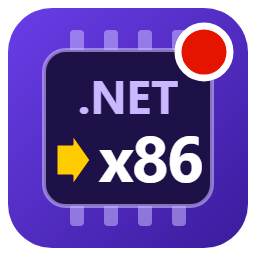
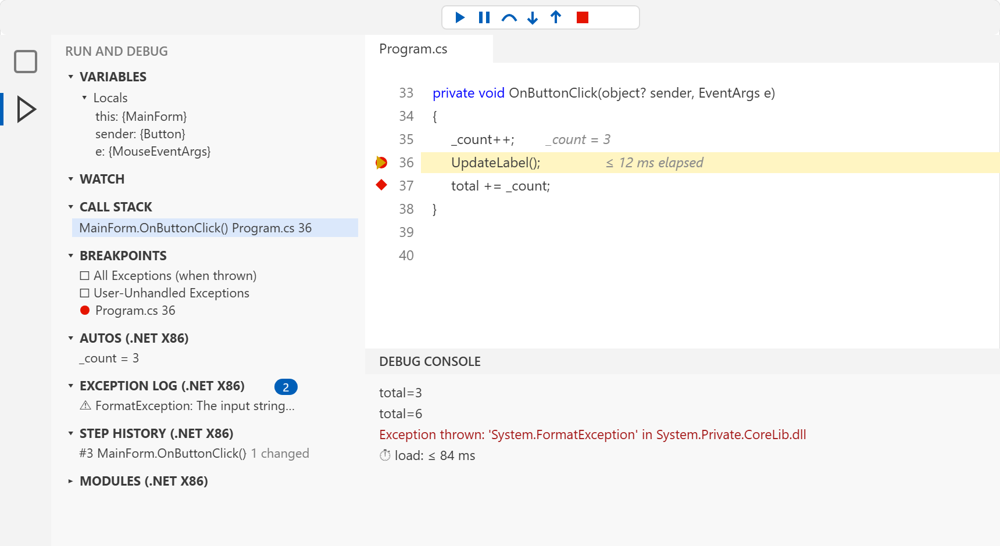
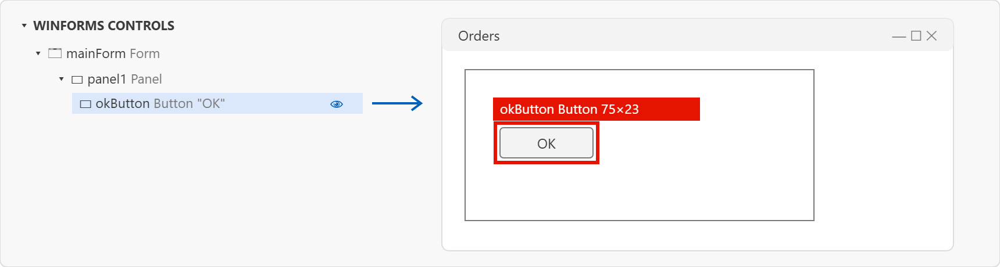
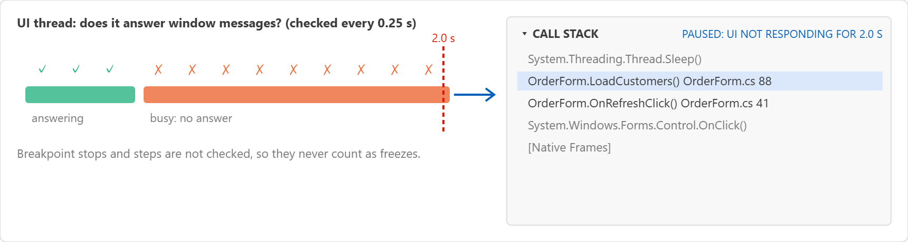
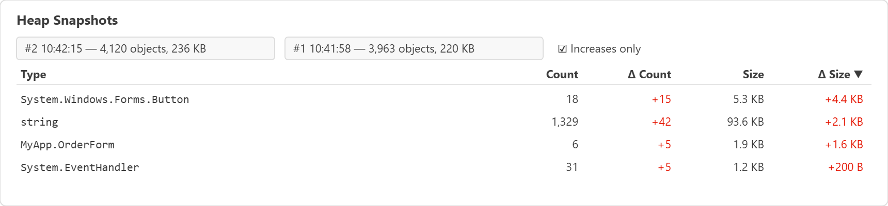

<p align="center"></p>

<h1 align="center">.NET x86 Debugger</h1>

<p align="center"><b>Debug 32-bit (x86) .NET and .NET Framework apps — WinForms included — in Visual Studio Code.</b></p>

<p align="center"><a href="https://github.com/takahino/vscode-dotnet-x86-debugger/releases"></a> <a href="https://github.com/takahino/vscode-dotnet-x86-debugger/actions/workflows/ci.yml"></a> <a href="LICENSE"></a></p>

<p align="center"><a href="README.jp.md">日本語</a> · <a href="https://takahino.github.io/vscode-dotnet-x86-debugger/usage.html">Illustrated guide</a> · <a href="CHANGELOG.md">Changelog</a></p>



The C# extension's debugger (vsdbg) ships only for x64 and arm64, so an app built with `<PlatformTarget>x86</PlatformTarget>`
cannot be debugged in VS Code. This extension bundles its own debug engine for x86, **dotnet-x86dbg** (Rust, x86 and x64),
behind a relay that adds the Visual Studio features you miss — and a few Visual Studio does not have. The debugger itself
uses no .NET, so .NET Framework apps can be debugged on a Windows without .NET installed.

## Quick start

1. Install the **.NET Desktop Runtime x86** (8 or later) from [dotnet.microsoft.com](https://dotnet.microsoft.com/download/dotnet), and a .NET SDK.
2. Install the extension: download the `.vsix` from [Releases](https://github.com/takahino/vscode-dotnet-x86-debugger/releases) and run **Extensions: Install from VSIX...**.
3. Open your project folder and run **.NET x86: Getting Started** — or just press **F5**: launch.json and the build task are made from your `.csproj`.

**.NET x86: Check Environment** tells you what is missing, and fixes the project file (x86, Portable PDB) with one click.

## Highlights

- **The Visual Studio debugger you know** — Exception Settings, Parallel Stacks and freezing threads, Set Next Statement,
  Step Into Specific, return values, Object IDs, DebuggerDisplay, PerfTips, the memory / CPU graph and heap snapshots.
- **…and more (★)** — breakpoints filtered by caller, UI freeze detection, a log of every exception with the locals at the throw,
  a unit test generated from a stop, value trends and section timings without stopping, a session report.
- **Made for WinForms** — the control tree of the stopped program, highlight a control on screen, stop in a control's event
  handlers, change its properties while stopped.
- **Into code that is not yours** — Source Link, symbol servers, and decompiling assemblies without symbols to step into them.
- **.NET 5+ and .NET Framework 4.x**, x86 and x64 (AnyCPU too), self-contained and single-file publishing; launch or attach (also by process name, waiting for it to start).

| | |
|---|---|
|  |  |



## Features

★ marks features Visual Studio does not have. Every feature is shown with pictures and use cases in the [illustrated guide](https://takahino.github.io/vscode-dotnet-x86-debugger/usage.html).

| Feature | What it does | Where |
|---|---|---|
| **Stopping where you want** | | |
| [Conditions, hit counts, logpoints](#hit-count-breakpoints) | Stop on a condition or the n-th pass; print without stopping | Gutter right-click |
| [Temporary / dependent / when-changed breakpoints](#temporary-dependent-when-changed-and-caller-filtered-breakpoints) | Stop once, after another breakpoint, or when a value changed | Editor right-click |
| [Caller-filtered breakpoints](#temporary-dependent-when-changed-and-caller-filtered-breakpoints) ★ | Stop only when a given method is a caller | Editor right-click |
| [Break on value change](#break-on-value-change) | Stop at the line that changes a field or variable | Variables right-click |
| [Exception breakpoints and settings](#exception-settings) | Stop on thrown / unhandled exceptions, by type or from a checklist | Breakpoints / Exception Settings view |
| [UI freeze detection](#ui-freeze-detection) ★ | Pause where the UI thread is stuck | Automatic |
| **Moving through code** | | |
| [Parallel Stacks, freezing threads](#parallel-stacks-and-freezing-threads) | All threads' stacks merged; keep a thread suspended | Call Stack right-click |
| [Step Into Target](#step-into-specific) | Step into one chosen call of the line | Editor right-click |
| [Set next statement](#set-next-statement) | Run a line again or skip lines | Editor right-click |
| [Edit and Continue](#edit-and-continue) | Change the code while debugging and keep going, without restarting | Save, or the debug toolbar |
| [Return values](#return-values) | See what the methods you stepped over returned | Variables / Autos |
| **Looking at values** | | |
| [Inline values, DebuggerDisplay, Autos](#inline-values) | Values next to the code and in compact views | Editor / Autos view |
| [Pinned values](#pinned-values) | Keep an expression at the end of a line | Editor right-click |
| [Object IDs](#object-ids) | Name an object ($1) and reach it from anywhere | Variables / Watch right-click |
| [Dump, table, image, C# initializer, string viewer, snapshots](#more-commands-in-the-variables-view-context-menu) | Read and compare complex values | Variables right-click |
| **Time, memory and performance** | | |
| [PerfTips](#perftips) | Time of the last step or continue at the line | Automatic |
| [Code coverage](#code-coverage) | Lines run, partly run and not run, colored in the editor; Cobertura XML | Setting |
| [Section timing, value trend](#section-timing) ★ | Time a section or chart values on every pass, without stopping | Editor right-click |
| [Memory / CPU graph](#memory--cpu-graph) | Private Bytes, Working Set and CPU over time | Command Palette |
| [GDI / USER objects, handles, address space](#memory--cpu-graph) ★ | Catch GDI leaks and a full 32-bit address space before the app crashes | Command Palette |
| [Heap snapshots](#heap-snapshots) | Objects per type on the GC heap, and what grew between two stops | Call Stack right-click |
| [GDI leak candidates](#heap-snapshots) ★ | Fonts, brushes, bitmaps, icons and windows that were not disposed, and which keep growing | Heap Snapshots panel |
| **History and records** | | |
| [Step history](#step-history) | The locals of every earlier stop | Step History view |
| [Exception log](#exception-log) ★ | Every thrown exception, swallowed ones too, with the stack and locals at the throw | Exception Log view |
| [Event trace](#event-trace) ★ | Which control's event fired, in what order and how far apart, without stopping | WinForms Controls right-click |
| [Capture evidence](#capture-evidence) ★ | Pictures of the open forms, control values, variables, call stack and SQL as Markdown + PNG for a test report | Command Palette / Call Stack right-click |
| [SQL log](#sql-log) ★ | Every SQL statement run through ODP.NET / SqlClient / OleDb / Odbc with its parameter values and caller, also from your own data access component | SQL Log view |
| [Session report](#debug-session-report) ★ | Markdown summary of the session for a bug report | Command Palette |
| [Generate a unit test](#generate-a-unit-test-from-a-stop) ★ | A test that replays the stopped method call | Call Stack right-click |
| **Source and symbols** | | |
| [Source in another folder](#debugging-referenced-assemblies-source-in-another-folder) | Find source whose PDB path is not on this machine | launch.json / settings |
| [Source Link and symbol servers](#source-link-and-symbol-servers) | Download the sources and PDBs of NuGet packages | Automatic / Modules right-click |
| [Debug decompiled assemblies](#debugging-decompiled-assemblies) | Step into exes and DLLs without symbols as C# | Automatic |
| **WinForms** | | |
| [WinForms Controls view](#winforms-controls-view) | The control tree of the open forms | WinForms Controls view |
| [Highlight on screen](#winforms-controls-view) ★ | Frame a control on the stopped form | Eye icon in the view |
| [Break on a control event](#winforms-controls-view) ★ | Stop in the handlers of a control's event, wherever they are | WinForms Controls right-click |
| [Change control properties](#winforms-controls-view) | Change text, visibility, colors, position or size while stopped | WinForms Controls right-click |
| [Data bindings](#winforms-controls-view) ★ | Every binding of a form with the value on each side; unconnected bindings and unsaved edits flagged | WinForms Controls view |
| **AI** | | |
| [AI clients (MCP)](#ai-clients-mcp) ★ | Let Copilot, Cursor, Claude Code, Codex and other AI assistants debug the session and operate the program's windows | Setting / Command Palette |

## Requirements

- Windows (x64)
- The **x86 .NET runtime** for your app, e.g. *.NET Desktop Runtime (x86)* for WinForms / WPF
  (installed under `C:\Program Files (x86)\dotnet`)
- A .NET SDK to build your project
- **.NET Framework 4.x** apps need nothing else (the debugger itself uses no .NET)

## Installation

1. Download `dotnet-x86-debugger-<version>.vsix` and `install-vsix.ps1` from
   [Releases](https://github.com/takahino/vscode-dotnet-x86-debugger/releases) into the same folder.
2. Run:

   ```powershell
   powershell -ExecutionPolicy Bypass -File install-vsix.ps1
   ```

   Alternatively, run **Extensions: Install from VSIX...** in VS Code and select the `.vsix`.

3. Reload VS Code (**Developer: Reload Window**).

## Setting up by hand

**.NET x86: Generate launch.json** (or F5 without a launch.json) writes this for you. To do it yourself:

1. Make your project 32-bit:

   ```xml
   <PropertyGroup>
     <TargetFramework>net10.0-windows</TargetFramework>
     <PlatformTarget>x86</PlatformTarget>
   </PropertyGroup>
   ```

2. Add a configuration to `.vscode/launch.json`:

   ```jsonc
   {
     "name": ".NET x86 Launch",
     "type": "dotnet-x86",
     "request": "launch",
     "preLaunchTask": "build",
     "program": "${workspaceFolder}/bin/x86/Debug/net10.0-windows/MyApp.exe",
     "args": [],
     "cwd": "${workspaceFolder}",
     "stopAtEntry": false
   }
   ```

   To attach to a running process:

   ```jsonc
   {
     "name": ".NET x86 Attach",
     "type": "dotnet-x86",
     "request": "attach",
     "processId": "${command:pickProcess}"
   }
   ```

   The process list shows only x86 .NET processes (with their window titles); choose *Show all processes...* for the rest.
   To attach as soon as an app starts (e.g. one launched by another program), give its name instead:

   ```jsonc
   {
     "name": ".NET x86 Attach (wait for process)",
     "type": "dotnet-x86",
     "request": "attach",
     "processName": "MyApp",
     "waitTimeout": 120
   }
   ```

3. Press F5.

See [`samples/WinFormsX86`](samples/WinFormsX86) for a complete example including `tasks.json`, and
[`samples/WinFormsNet48X86`](samples/WinFormsNet48X86) for the same with .NET Framework 4.8.
**[`samples/FeatureTour`](samples/FeatureTour)** is a WinForms app with one button per feature, for .NET 10 and .NET Framework 4.8.

## Configuration

### Launch options

| Option | Description |
|---|---|
| `program` | Path to the x86 `.exe`. A framework-dependent `.dll` is also accepted and is started with the x86 `dotnet.exe`. |
| `args` | Command line arguments. |
| `cwd` | Working directory. |
| `env` | Environment variables. |
| `stopAtEntry` | Break at the entry point. |
| `justMyCode` | Only debug user code (default `true`). |
| `enableStepFiltering` | Step over properties and operators (default `true`). |
| `expressionEvaluationOptions` | With `allowImplicitFuncEval: false`, the Variables view does not run property getters and `ToString()` by itself; they run when expanded (a guard against getters with side effects). Also for attach. |
| `architecture` | When `program` is a framework-dependent `.dll`: the bitness of the `dotnet.exe` that runs it (`x86` by default, or `x64`). An `.exe` runs as it was built, and the debugger of that bitness is used. |
| `decompile` | `app` (default): assemblies of the program without symbols are decompiled to C# when needed (see "Debugging decompiled assemblies"); `off`: not. Attach too. |
| `childProcesses` | Processes the program starts with `Process.Start`: `record` (default) logs them, `follow` also debugs a .NET child in its own session from its first line (a .NET Framework child once its runtime has loaded), `off` ignores them. Attach too. |
| `dumpPath` | Open this crash dump (`.dmp` with full memory: Task Manager "Create dump file", WER LocalDumps, `procdump -ma`) instead of starting a program. It shows as a stopped program (threads, call stacks, variables, the exception, heap snapshots); it cannot continue, step or run functions. `program` is not needed. |
| `sourceFileMap` | Replace source path prefixes recorded in PDBs with local folders (see below). Attach too. |
| `sourceSearchPaths` | Folders searched for source files the PDB records elsewhere (see below). Attach too. |

### Settings

| Setting | Description |
|---|---|
| `dotnetX86.debuggerPath` | For x86 programs, use another build of the x86 debug engine (`dotnet-x86dbg.exe`) instead of the bundled one. |
| `dotnetX86.sourceFileMap` / `dotnetX86.sourceSearchPaths` | `sourceFileMap` / `sourceSearchPaths` for every configuration (`${workspaceFolder}` can be used). |
| `dotnetX86.sourceLink.enabled` | Download sources through the PDB's Source Link map (default `true`). |
| `dotnetX86.symbolServers` | Symbol servers for **Download Symbols** (default NuGet and Microsoft). |
| `dotnetX86.trace` | Troubleshooting: log the debug adapter traffic to the *.NET x86 Debugger* output channel and write a log of the debug engine (its path is shown there). |
| `dotnetX86.mcp.enabled` | Let AI clients debug through MCP (default `false`; see [AI clients](#ai-clients-mcp)). |
| `dotnetX86.editAndContinue.enabled` | Edit and Continue (default `true`; see [Edit and Continue](#edit-and-continue)). |
| `dotnetX86.editAndContinue.applyOnSave` | Apply the edit when a C# source is saved while debugging (default `true`). |
| `dotnetX86.stepHistory.enabled` | Record every stop in the Step History view (default `true`). |
| `dotnetX86.exceptionLog.captureLocals` | Record the call stack and locals with each logged exception (default `true`). |
| `dotnetX86.exceptionLog.enabled` | Record every thrown exception in the Exception Log view without stopping (default `true`). |
| `dotnetX86.sqlLog.methods` | Provider methods the SQL log reads commands at, as `Namespace.Type.Method` (default: ODP.NET, SqlClient, OleDb, Odbc). |
| `dotnetX86.evidence.folder` | Where Capture Evidence saves, relative to the workspace folder (default `evidence`). |
| `dotnetX86.uiFreeze.enabled` | Pause the program when its UI stops responding (default `true`). |
| `dotnetX86.uiFreeze.thresholdMs` | How long a UI thread may not respond before pausing (default `2000`). |
| `dotnetX86.perfTips.enabled` | Show the elapsed time at the stopped line after a step / continue (default `true`). |
| `dotnetX86.coverage.enabled` | Count code coverage in new debug sessions, unless launch.json sets `coverage` (default `false`). |
| `dotnetX86.coverage.folder` | The folder (absolute) for the Cobertura XML (default `%LOCALAPPDATA%\dotnet-x86dbg\coverage`). |
| `dotnetX86.coverage.showInEditor` | Color the lines in the editor while counting coverage (default `true`). |
| `dotnetX86.memoryGraph.autoOpen` | Open the memory graph automatically when debugging starts (default `false`). |
| `dotnetX86.heapSnapshot.collectGarbage` | Run a garbage collection right before each heap snapshot (default `true`). |
| `dotnetX86.dump.maxDepth` | Nesting depth expanded by *Dump Variable* (default `3`). |
| `dotnetX86.dump.maxNodes` | Stop expanding once this many values have been collected (default `2000`). |

#### Turning features off

Every feature is on by default. Set one of these to `false` to remove its views, menu entries and commands, and to stop
the work it does in the background (sampling, evaluating at each stop). The change applies at once; the memory graph,
the exception settings, the exception log, the SQL log and UI freeze detection change with the next debug session.

| Setting | Feature |
|---|---|
| `dotnetX86.memoryGraph.enabled` | Memory / CPU / GDI graph (no sampling at all) |
| `dotnetX86.inlineValues.enabled` | Inline values |
| `dotnetX86.autos.enabled` | Autos view |
| `dotnetX86.modules.enabled` | Modules view, Download Symbols |
| `dotnetX86.exceptionSettings.enabled` | Exception Settings view (and stopping on the types checked in it) |
| `dotnetX86.winforms.enabled` | WinForms Controls view and its commands, Show Data Bindings |
| `dotnetX86.heapSnapshot.enabled` | Heap Snapshots and GDI leak candidates |
| `dotnetX86.parallelStacks.enabled` | Parallel Stacks, Freeze / Thaw Thread |
| `dotnetX86.valueTrend.enabled` | Value trend and section timing |
| `dotnetX86.pinnedValues.enabled` | Pinned values (kept, shown again when turned back on) |
| `dotnetX86.breakpointCommands.enabled` | The breakpoint commands of the editor context menu (the `#once` / `#after` / `#changed` / `#caller` conditions keep working) |
| `dotnetX86.variableTools.enabled` | Variables / Watch context menu commands (Dump, View as Table / Image, Copy as C#, View String, snapshots, Object ID) |
| `dotnetX86.generateTest.enabled` | Generate Unit Test from Here |
| `dotnetX86.sessionReport.enabled` | Export Debug Session Report |
| `dotnetX86.stepHistory.enabled` | Step History view and recording |
| `dotnetX86.exceptionLog.enabled` | Exception Log view and recording |
| `dotnetX86.sqlLog.enabled` | SQL Log view and recording |
| `dotnetX86.eventTrace.enabled` | Trace Events and the Event Trace view |
| `dotnetX86.evidence.enabled` | Capture Evidence |
| `dotnetX86.perfTips.enabled` | PerfTips |
| `dotnetX86.uiFreeze.enabled` | UI freeze detection |
| `dotnetX86.sourceLink.enabled` | Source Link downloads |

### .NET Framework 4.x

`.NET Framework` apps (`net48`, `net472`, ...) are debugged the same way: point `program` at the x86 `.exe`
(e.g. `bin/x86/Debug/net48/MyApp.exe`). The extension recognizes the .NET Framework exe and starts it with the
.NET Framework runtime; attaching works too.

- The project must produce **Portable PDBs**. SDK-style projects do; old-style projects write Windows PDBs by default —
  add `<DebugType>portable</DebugType>` (the extension warns when it finds a Windows PDB).
- Only .NET Framework 4.x is supported (not 2.0 / 3.5).
- No .NET (Core) runtime is needed. x64 and AnyCPU exes (without *Prefer 32-bit*) are debugged with the x64 debugger.

### Display language

Menus, settings and messages are shown in English, or in Japanese when VS Code's display language is Japanese
(e.g. with the Japanese Language Pack).

## Feature guide

The same features with pictures and use cases: [illustrated guide](https://takahino.github.io/vscode-dotnet-x86-debugger/usage.html).

### Stopping where you want

#### Hit count breakpoints

Edit a breakpoint and choose **Hit Count**, then enter `5` or `==5` (stop on the 5th hit), `>=5` / `>5`
(from the 5th / after the 5th hit) or `%5` (every 5th hit). It can be combined with a condition (hits are counted
only when the condition is true) and with a log message.

#### Logpoints

Right-click the editor gutter and choose **Add Logpoint...**, then enter a message such as
`i={i} total={total} in $FUNCTION`. Each time the line runs, the message is written to the Debug Console
and execution continues without stopping. `{expression}` is evaluated in the current frame;
`$FUNCTION` and `$TID` are replaced with the method name and thread id. A condition can be combined with a logpoint.

#### Temporary, dependent, when-changed and caller-filtered breakpoints

Right-click a line in a C# editor:

- **Add Temporary Breakpoint** — stops once, then the breakpoint removes itself (condition `#once`).
- **Add Dependent Breakpoint...** — active only after the program has stopped at another breakpoint you pick (condition `#after File.cs:12`).
- **Add Breakpoint When Value Changes...** — stops only when an expression has a different value than the last time the line ran; the old and new values are written to the Debug Console (condition `#changed expr`).
- **Add Breakpoint Filtered by Caller...** — stops only when the line is reached through one of the methods you pick
  (while stopped, the methods of the current call stack are offered); `!Name` stops unless called from it
  (condition `#caller Orders.Save, Import.Run`). Names match from the end: `Save`, `Orders.Save` or `MyApp.Orders.Save`.
  Visual Studio has no such filter.

You can also type these markers as the condition of any breakpoint. They can be combined with a hit count.

#### Break on Value Change

Right-click a field, property or local variable in the Variables view and choose **Break on Value Change**.
Execution stops right after the value changes, showing `old → new`. It is not a hardware data breakpoint but
emulated: the extension finds the lines of the workspace's C# files that assign that name (`x = …`, `x += …`, `x++`, …),
checks the value before and after each of them, and stops only when it changed. Writes through `ref` / `out`,
from other objects (`other.x = …`) or from code outside the workspace are not detected.

#### Exception breakpoints

The Breakpoints view shows **All Exceptions (when thrown)** and **User-Unhandled Exceptions**. Right-click one and
choose **Edit Condition** to limit it to exception types, e.g. `System.NullReferenceException, System.InvalidOperationException`;
start with `!` to break on every type except those.

#### Exception settings

The **Exception Settings (.NET x86)** view lists common exception types by namespace, as Visual Studio's Exception Settings
window does: check a type (or a whole namespace) to stop whenever it is thrown, even when it is caught later. Add your own
types with **+**, or right-click an entry of the Exception Log and choose **Break When This Type Is Thrown**. The checks are
kept with the workspace and apply at once, also while the program runs. They add to the exception breakpoints of the
Breakpoints view.

#### UI freeze detection

When the program's UI stops responding — a UI thread does not process window messages for 2 seconds
(`dotnetX86.uiFreeze.thresholdMs`) — the program is paused on that thread, so the Call Stack shows the code that holds
the UI up, and the pause is labeled *UI not responding for 2.0 s*. Steps and stops at breakpoints never count as freezes.
Visual Studio has no such option. Turn it off with `dotnetX86.uiFreeze.enabled`.

If the UI thread is waiting inside native code (e.g. `Thread.Sleep`, a lock), the top frames are framework / native ones:
look a few frames down for your code. Expressions cannot be evaluated in such a frame (pick one of your own frames).

### Moving through code

#### Step Into Specific

On a line with several calls, such as `Outer(Inner1(), Inner2())`, right-click and choose **Step Into Target** (or run it
from the Command Palette) and pick the call to step into; the others run without stopping. The calls are listed in the
order they run (arguments first). The step goes over the line with a temporary
function breakpoint on the picked method: if the line does not call it after all, the step ends on the next line.
Constructors (`new T(...)`) are not listed.

#### Set Next Statement

While stopped, right-click a line of the method that is executing and choose **Jump to Cursor** (Set Next Statement)
to move execution there: run a line again or skip lines, as in Visual Studio. Lines outside the executing method,
or moving into / out of a catch / finally block, are refused.

#### Edit and Continue

While debugging, edit a C# source of the program and save it: the change is applied to the running program, without
restarting and without losing its state (the screens you went through, the data loaded). The command **.NET x86: Apply
Code Changes** (the flame on the debug toolbar) does the same for every source.

- Changed methods run the new code from their next call. A method that is stopped (or running) moves to the new code at
  its next statement, keeping its local variables; when the line it is on was itself changed, it finishes with the old
  code and the next call runs the new one (the Debug Console says so).
- You can change method, constructor and property bodies, and add methods, fields, properties and classes (.NET and .NET
  Framework). Lines that moved keep their breakpoints and stack lines right.
- Changes that cannot be applied while running, such as a changed signature, a removed member, a changed field
  initializer, or a type's base class, are refused with the file and line; restart then (**Restart Debugging** on the
  message). Compile errors are shown the same way and nothing is applied.
- It works for a Debug build started by the debugger (not attached), with portable PDBs. The change is built by the
  compiler of the installed **.NET SDK 9 or later**, from the sources as they were when debugging started.
- Settings: `dotnetX86.editAndContinue.enabled` (off: modules load as before) and `dotnetX86.editAndContinue.applyOnSave`.
  AI clients apply their edits with the MCP tool `debug_apply_changes`.

#### Return values

After **Step Over** (or Step Into a line that calls no code of yours) and **Step Out**, the values returned by the
methods that were called are shown at the top of the Variables and Autos views, e.g. `Program.Square returned = 9`.
A line with several calls shows each of them. Objects can be expanded; their text is the type name
(`DebuggerDisplay` is not applied to them). The values disappear at the next step or continue.
Methods that return `decimal`, `DateTime`, `Nullable<T>` or a struct larger than 4 bytes pass the value through a hidden
buffer on x86, and their return values are not shown.

#### Parallel Stacks and freezing threads

Right-click in the Call Stack view and choose **Show Parallel Stacks** (or run it from the Command Palette): the call stacks of
all threads are merged into boxes, as in Visual Studio — callers at the bottom, a box per path the threads share, with the
number of threads. Click a frame to open it; the panel follows every stop.

Right-click a thread in the Call Stack view and choose **Freeze Thread** (or use the buttons in the panel): a frozen thread
stays suspended when the program continues, also across expression evaluation, until **Thaw Thread**. Its name shows
`[frozen]`. Use it to let one thread run alone, or to hold one back to provoke a race.

### Looking at values

#### Inline values

While stopped, values are shown at the end of the lines of the current method, like Visual Studio's inline values:
locals and parameters, and fields (`_count`, `this._count`). Properties are not shown, since reading them runs getters.
Turn this off with the VS Code setting `debug.inlineValues`.

#### DebuggerDisplay

Types with `[DebuggerDisplay("Name = {Name}, Age = {Age}")]` are shown with that text in the Variables view,
hovers and the Watch view, as in Visual Studio (`List<T>` shows `Count = 3`). Member access and method calls work,
`,nq` removes the quotes around strings, and the attribute is inherited. Expressions are evaluated relative to the
object, so complex expressions (operators, casts) fall back to the default `{Type}` text.

#### Autos and Modules views

- **Autos (.NET x86)**: the variables used on the current and the previous line of the selected frame, as in Visual Studio.
- **Modules (.NET x86)**: the loaded assemblies and whether their symbols (PDB) were loaded; right-click to copy the path
  or reveal the file.

#### Pinned values

Right-click a line and choose **Pin Value to Line...** to show an expression at the end of that line. It is evaluated
again in the selected stack frame every time the program stops, and the pins are kept with the workspace.
Use **Unpin Value from Line** or **Clear All Pinned Values** to remove them.

#### Object IDs

Right-click an object in the Variables or Watch view and choose **Make Object ID**: it gets a name, `$1`, `$2`, ..., that
reaches that very object from any method and any later stop — in Watch, the Debug Console, hovers and breakpoint conditions
(e.g. `$1.Count`, `order == $2`). Values that are that object show `{$1}` in the Variables view. As in Visual Studio, an object ID
does not keep its object alive: once it is garbage collected, `$1` is `null`. IDs last until the debug session ends.
Objects only (not numbers, strings, structs or null).

#### Dump Variable

While stopped, right-click a variable in the **Variables** view and choose **Dump Variable**,
or run **.NET x86: Dump Expression...** from the Command Palette, to open the whole object as JSON in an editor.

```json
{
  "p": {
    "$type": "Person",
    "Name": "Alice",
    "Friends": [ { "$type": "Person", "Name": "Bob" } ],
    "Scores": { "math": 90 }
  }
}
```

- `List<T>` and `Dictionary<TKey, TValue>` are shown as their items, like Visual Studio's *Results View*.
- Static members, explicit interface implementations and indexers are omitted.
- Property getters run while dumping, as in the Variables view. Large objects such as a `Form` hit the limits above
  (a notification tells you so); raise them in the settings if needed.

#### More commands in the Variables view context menu

| Command | What it does |
|---|---|
| **View as Image** | Shows a `System.Drawing` `Image` / `Bitmap` / `Icon` as a picture (fit, actual size, zoom; transparency on a checkerboard) with its size and pixel format. The program saves it to a temporary PNG, which is deleted at once. Also in the Watch view. |
| **View as Table** | Shows a `List<T>`, array, `Dictionary` or `DataTable` as a table: click a header to sort, filter rows, and copy or save it as CSV. Object items get one column per member; dates are shown with `ToString()`. Up to 1,000 rows of a DataTable are read. |
| **Copy as C# Initializer** | Copies the value as C# code (`var order = new Order { Note = "...", People = new List<Person> { ... } };`), handy for test data. Only PascalCase members are emitted; get-only properties are included too, so delete them if the code does not compile. |
| **View String (JSON / XML / HTML / Text)** | Opens a `string` variable in an editor, pretty-printed when it contains JSON, XML or HTML (auto-detected, or pick the format). |
| **Take Snapshot** / **Compare with Snapshot** | Records the variable, then shows a diff against its current value after you step or continue — find out what changed and where. |

### Time, memory and performance

#### PerfTips

After a step or continue, the stopped line shows the elapsed time (e.g. `≤ 12 ms elapsed`). It includes the debugger's
own overhead, hence "≤".

#### Code coverage

Turn on `dotnetX86.coverage.enabled` (or set `"coverage": true` in launch.json) and debug. The engine counts the lines
and branches the program runs, and the editor colors the lines as they run: green run, yellow partly run (hover for the
branches taken), red not run. The status bar shows the rates; click it (or **Write Coverage XML**) to write the Cobertura
XML, which is also written when the session ends. The colors stay after the session to review them.

#### Section timing

Right-click a line and choose **Start Timer Here...**, then right-click a later line and choose **End Timer Here...**.
Each pass from start to end is measured without stopping and charted in the **Value Trend** view (`⏱ name (ms)`),
also written to the Debug Console. Each pass includes a few milliseconds of debugger overhead.

#### Value trend

Right-click a line in a C# file and choose **Track Value at This Line...**, then enter expressions separated by `;`
(e.g. `total; items.Count`). Each time the line runs, the values are recorded without stopping and charted hit by hit,
one small chart per expression (**.NET x86: Show Value Trend**). It is a logpoint whose message starts with `#track:`,
so it is removed like any breakpoint.

#### Memory / CPU graph

Run **.NET x86: Show Memory / CPU Graph** from the Command Palette (or set `dotnetX86.memoryGraph.autoOpen` to `true`)
to see the debuggee's **Private Bytes** and **Working Set**, plus its **CPU usage** (% of all cores, as in Task Manager)
in a second chart, once per second, like the process memory / CPU graphs of Visual Studio's Diagnostic Tools. Periods stopped at a breakpoint or step are shaded; hover to read the values,
and open *Data table* for the latest samples.

Below them, what Visual Studio does not show:

- **GDI / USER objects** and **handles**. Windows allows a process 10,000 GDI objects and 10,000 USER objects; a WinForms
  app that never disposes its `Font`, `Brush`, `Pen`, `Bitmap` or `Icon` objects climbs steadily until drawing fails and it
  crashes. The limit line appears once a count passes half of it.
- **32-bit address space**: reserved + committed bytes against the limit (2 GB, or 4 GB for a large address aware exe), and
  the largest free block. An x86 app gets `OutOfMemoryException` when no free block is big enough, with plenty of memory left
  on the machine.

A warning appears at 80 % of the GDI / USER limit, and when the address space is 85 % full or its largest free block is under 128 MB.

#### Heap snapshots

While stopped, right-click in the Call Stack view and choose **Take Heap Snapshot** (or run it from the Command Palette):
the number of objects and their bytes per type on the GC heap are listed, largest first, as in Visual Studio's Memory Usage.
Take another one at a later stop to see what changed per type (**Δ Count**, **Δ Size**); pick any two snapshots to compare,
sort by a column, filter by name, or show **Increases only**. A garbage collection runs right before each snapshot so that
only objects still in use are counted (`dotnetX86.heapSnapshot.collectGarbage`).

Above the types, **GDI leak candidates** lists the objects that hold a native resource — GDI+ fonts, brushes, pens, images,
graphics, regions and paths; icons, cursors and windows — with how many are **not disposed** (they still hold their handle)
and how that changed since the snapshot compared with. Take a snapshot, repeat an action a few times (open and close a
form, print a report), take another: a type whose *Not disposed* keeps growing is marked *⚠ leak candidate*. Visual Studio
cannot tell a disposed object from one that was not. Works for .NET and .NET Framework.

### History and records

#### Step history

The **Step History (.NET x86)** view in Run and Debug records the location and the local variables at every stop,
newest first. Values that changed since the previous stop in the same method are marked *changed* / *new*, so you can
look back at "the value three steps ago" (it is a history to browse; execution does not run backwards).
Click an entry to open its location. Turn it off with `dotnetX86.stepHistory.enabled`.

#### Exception log

The **Exception Log (.NET x86)** view lists every exception thrown in the debuggee, including ones that are caught
and swallowed, with type, message and the first location in your code (click to open it). They are also written to the
Debug Console like Visual Studio's `Exception thrown: …` lines. Execution only stops where your exception settings say so.
Apps that throw very many exceptions run slower while it is on (`dotnetX86.exceptionLog.enabled`).

Each entry expands into a **snapshot taken at the throw**: the call stack (click a frame to open it) and the locals of the
first three frames of your code, so you can see the values of an exception you ran through without stopping. Visual
Studio does not keep them. Objects are not expanded; see `dotnetX86.exceptionLog.captureLocals`.

#### Event trace

Right-click a control in the WinForms Controls view and choose **Trace Events...**, pick its event handlers, and continue. The
**Event Trace (.NET x86)** view then lists every firing in order — the event, the control that fired it (the handler's
`sender`), the handler, the time and the gap to the previous one — without stopping, so a chain such as `Validating` →
`TextChanged` → `SelectedIndexChanged` can be read at a glance. Click an entry to open the handler. **Export Event Trace**
writes the list to a text file. A handler you also set a breakpoint on still stops. `dotnetX86.eventTrace.enabled`.

#### Capture evidence

**.NET x86: Capture Evidence** (Command Palette, Call Stack context menu, WinForms Controls view title) saves what a test
report needs from the stopped screen into a new folder (`evidence/<date-time>/`, see `dotnetX86.evidence.folder`): a **picture of
every open form**, the **values of their controls** (text, checked, selected index, the first cells of each DataGridView and the
state hidden / disabled), the variables of the selected frame, the call stack and the SQL run since the previous capture,
as `evidence.md` plus PNG files. The pictures are the desktop compositor's last image of the stopped windows, shown on top for
a moment, so they work when the form is behind VS Code; a form has to be on a screen (not minimized). At most 300 controls
are read per form. `dotnetX86.evidence.enabled`.

#### SQL log

The **SQL Log (.NET x86)** view lists every SQL statement the program runs through an ADO.NET provider — ODP.NET (managed and
unmanaged), SqlClient, OleDb and Odbc — without stopping. Each entry shows the statement, its **parameter values** and the
**caller** (expand it for the call stack), and **Copy SQL with Parameter Values** gives the statement with every `:name` /
`@name` / `?` replaced by its literal value, ready to paste into a SQL tool. Oracle's `BindByName = false` (bind by position)
is honored. A statement that runs five times or more is flagged, the usual shape of an N+1 problem. **Export SQL Log** (view
title) writes them all to a `.sql` file as evidence of what the program ran.

It hooks the provider, not your code, so statements run by a home-made data access component are logged too. Each
statement pauses the program for a moment while it is read (`dotnetX86.sqlLog.enabled`, new sessions only). To log another
provider, add its command type to `dotnetX86.sqlLog.methods` (e.g. `Npgsql.NpgsqlCommand.ExecuteReader`). The time a
statement took is not recorded, and `Async` methods are only logged where the provider calls its synchronous method.

#### Debug session report

Run **.NET x86: Export Debug Session Report** (or the button in the Step History view title) to open a Markdown report of
the last session: program, start / end time and exit code, every stop with the values that changed, the exceptions
(with a count per type), section timings (min / avg / max), tracked values and the modules with symbols. Save it or paste
it into a bug report.

#### Generate a unit test from a stop

Right-click a frame in the Call Stack view and choose **Generate Unit Test from Here**: a test that calls that method again
with the arguments — and, for an instance method, the object — it has now opens beside the editor (unsaved). The test
framework is the one the workspace's projects reference (xUnit, NUnit or MSTest); you are asked when there is none or several.
Fill in `expected` and save it in your test project. Async methods work too; lambdas, local functions and constructors cannot
be called from a test, so pick the method that uses them. The values are those at the stopped line: stop at the first line
of the method to capture the arguments as they came in. Visual Studio has no such command.

#### Debug.WriteLine

Output from `Debug.WriteLine`, `Trace.WriteLine` and `Debugger.Log` appears in the Debug Console, with a link to the source line.

### Source and symbols

#### Debugging referenced assemblies (source in another folder)

To step into your own library (e.g. a NuGet package you build) whose PDB records paths that do not exist on this
machine, tell the debugger where the source is:

```jsonc
"justMyCode": false,                          // when the library is built Release (optimized)
"sourceSearchPaths": ["D:\\work"],             // searched with subfolders; the best match of the trailing folders wins
"sourceFileMap": { "/_/": "D:\\work\\MyLib\\" } // or replace a path prefix exactly (deterministic builds record /_/)
```

- The library's PDB must be readable: embedded in the .dll or next to it (Portable PDB).
- The PDBs of the assemblies next to the launched program are read before the session starts, so breakpoints in the
  library work from the beginning; assemblies loaded later (and attach) get their breakpoints moved when they load.
- Both can also be set for every configuration with `dotnetX86.sourceFileMap` / `dotnetX86.sourceSearchPaths`.
- When a stop has no source on this machine, the Debug Console says which PDB path to map.

#### Source Link and symbol servers

Most NuGet packages built from GitHub carry a **Source Link** map in their PDB (the .NET 8+ SDK adds one by default).
When the program stops in a file that is not on this machine, the extension downloads it from the URL the map gives
(e.g. raw.githubusercontent.com) into its storage and opens it; breakpoints in it work. Turn it off with
`dotnetX86.sourceLink.enabled`.

For an assembly without symbols, right-click it in the **Modules** view and choose **Download Symbols**: its PDB is fetched
from the NuGet and Microsoft symbol servers (`dotnetX86.symbolServers`), and applies from the next debug session (a button
restarts the current one). With Source Link, its sources follow. When no server has the PDB, the debugger decompiles the assembly (below).
**Delete Downloaded Symbols and Sources** clears both caches. Downloads are listed in the *.NET x86 Debugger* output.

#### Debugging decompiled assemblies

The debugger decompiles the program's own assemblies that have no symbols (an exe shipped without its PDB, a DLL whose
source you do not have) by itself, when you first stop in them, step into them or set a breakpoint in their decompiled file:
the call stack then points at C# files, and breakpoints, stepping and locals work in the same session. No .NET runtime is
needed for it. The files are written to `%LOCALAPPDATA%\dotnet-x86dbg\decompiled`; methods that cannot be turned into C#
are shown as IL. .NET's own assemblies are not decompiled. Set `"decompile": "off"` in launch.json to turn it off. AI clients
read the decompiled sources with the MCP tool `decompile`.

When the program itself has no symbols, all of its assemblies without symbols count as your code (Just My Code steps into
them). When the program has its PDB, a DLL without symbols does not: set `"justMyCode": false` to step into it. The Modules
view shows such assemblies as *decompiled*. The assembly's own folder is not touched, and names of locals are the
decompiler's (from their types), not the original ones.

### WinForms

#### WinForms Controls view

While stopped, the **WinForms Controls** view in Run and Debug lists `Application.OpenForms` and their controls as a tree
(name, type and text; hidden controls are greyed out). Hover a control for its bounds, enabled state, dock and tab index.
Right-click it to **Dump Control** or **Copy Expression** (e.g. `System.Windows.Forms.Application.OpenForms[0].Controls[1]`,
which you can paste into the Watch view). Every value is read by evaluating an expression, so children are read only when
you expand a node.

Right-click a control and choose **Break on Event...** to see the handlers attached to its events (e.g. *Click →
`MainForm.OnSaveClick`*, lambdas too) and stop in the ones you pick the next time the event fires — without knowing
where they are in the code. They are added as function breakpoints in the Breakpoints view. Visual Studio has no such
command.

Right-click a control and choose **Change Property...** to change its `Text`, `Visible`, `Enabled`, colors, position or
size (or any property, with a C# expression as the value) in the stopped program; it shows on screen when the program
continues. `Dock` and `Anchor` take member names, such as `Fill` or `Top, Left`.

Click the eye icon (**Highlight on Screen**) to see where a control is: the form is shown in front, as it was when the
program stopped, with a red frame and the control's name and size around it for a few seconds. Visual Studio cannot do
this for WinForms. (The stopped program cannot repaint or come to the front itself; the image comes from the desktop compositor.)

Click the link icon in the view title (**Show Data Bindings**, every open form) or right-click a control (that control and the
ones inside it) to list its **data bindings** in a table, which Visual Studio cannot show:

- **Simple bindings** (`Control.DataBindings`): the control property, the data source (through a `BindingSource`, with its
  filter and sort), the member, the **value in the control and the value in the current item** side by side, the position in
  the list, the update mode and the format string. *⚠ not connected* marks a binding whose member does not exist;
  *≠ differs* marks a control showing something else than its item holds — typically an edit not written back yet.
- **List bindings** (`DataSource` of a ComboBox, ListBox or DataGridView): the data source, `DataMember` / `DisplayMember` /
  `ValueMember`, the selected value and the position.

The values are those of the stop: press **Refresh** after the next one. Each row has a button that highlights its control on
the screen. A form with many controls takes a few seconds (about 5 evaluations per control); the progress can be cancelled.

### AI clients (MCP)

Turn on `dotnetX86.mcp.enabled` and AI assistants can debug the program you started in VS Code through MCP (Model Context
Protocol): set breakpoints, continue and step, read the call stack, variables and expressions — and operate the program's
windows to reproduce a problem, then look at where it stopped. The Run and Debug views follow what the AI does, and your
breakpoints and the AI's do not remove each other. The setting is off by default: the tools evaluate expressions and
operate windows in your program.

- **VS Code's AI** (Copilot Chat in agent mode, VS Code 1.101 or later): while debugging, the session is the MCP server
  *.NET x86 Debugger*. Enable its tools in the chat's tool picker.
- **Cursor's AI**: in Cursor, while the setting is on, the server *dotnet-x86* is registered for you (Cursor's MCP
  extension API). Enable it in Cursor's MCP settings if Cursor asks.
- **Other AI clients**: run **.NET x86: Register the MCP Server with AI Clients** once and pick the clients (the ones
  found on this PC come first). Clients started afterwards (or their new sessions) see the server *dotnet-x86*.

  | Client | How it is registered |
  |---|---|
  | Claude Code (the terminal and the Claude Code extension) | `claude mcp add --scope user dotnet-x86 -- "<path>" --mcp-connect` |
  | GitHub Copilot CLI | `copilot mcp add dotnet-x86 -- "<path>" --mcp-connect` |
  | Codex (the CLI, the IDE extension and the ChatGPT app) | `[mcp_servers.dotnet-x86]` in `~/.codex/config.toml` |
  | Gemini CLI | `mcpServers` in `~/.gemini/settings.json` |
  | Claude Desktop | `mcpServers` in `claude_desktop_config.json` (the Microsoft Store app's own copy when installed from there) |
  | Cursor (when you debug in VS Code) | `mcpServers` in `~/.cursor/mcp.json` |
  | Windsurf | `mcpServers` in `~/.codeium/windsurf/mcp_config.json` |
  | LM Studio | `mcpServers` in `~/.lmstudio/mcp.json` |
  | opencode | `mcp` in `~/.config/opencode/opencode.json` |

  A settings file keeps everything else; the file before the change is saved beside it as `<file>.dotnet-x86.bak`. A file
  with comments is left alone (the command says so and offers to copy the settings). For a client not in the list, or to
  register by hand, run **.NET x86: Copy MCP Connection Settings for AI Clients**: it copies the command or the settings
  for the client you pick, or an `mcpServers` JSON, which most clients read.

  `<path>` is a copy of the debug engine in `%LOCALAPPDATA%\dotnet-x86dbg\bin` that the extension keeps up to date, so you
  register it once. It connects to the latest debug session started in VS Code or Cursor (with the setting on); while there is none,
  its tools say so.

| Tools | What they do |
|---|---|
| `debug_status`, `debug_wait_for_stop`, `debug_stop_context` | Where the program stopped and why, with the source around it and the locals |
| `breakpoint_set` / `_remove` / `_list` / `_clear`, `trace_log` | Breakpoints on lines or methods, with conditions; tracepoints (log without stopping) |
| `debug_continue`, `debug_step`, `debug_pause`, `debug_terminate` | Run and step |
| `threads`, `stack_trace`, `variables`, `evaluate`, `set_variable`, `exception_info`, `source_context`, `modules`, `debug_output` | Read the stopped program |
| `ui_tree`, `ui_find` | The program's windows and controls (WinForms, WPF): kind, name (`Control.Name`, `x:Name`), text, state, screen and window coordinates |
| `ui_screenshot` | A PNG of a window, a control, every window of the program or the screen — also while stopped, optionally with numbered marks on the controls |
| `ui_invoke`, `ui_set_text`, `ui_select`, `ui_toggle` | Press a button, type into a box, pick an item, check a box — without moving the mouse |
| `ui_keys`, `ui_mouse`, `ui_window`, `ui_wait_for` | Real keyboard and mouse input at coordinates; bring forward, move or close a window; wait for a control |

An action that hits a breakpoint in an event handler returns where it stopped. Controls are read one by one for WinForms
and WPF (names are `Control.Name` / `x:Name`); for other UI frameworks the tools work on windows, coordinates and screenshots. The engine listens on 127.0.0.1 only, with
a token made for each session (kept in your profile's `%LOCALAPPDATA%`), and refuses requests from web pages.

## Limitations

- **.NET Framework**: 4.x only, with Portable PDBs (embedded ones too; see above).
- The debuggee always runs with its output in the Debug Console (`console: integratedTerminal` is not available).
- Windows only. The debugged process is x86 or x64 (ARM64 is untested).

## Differences from Visual Studio

The extension brings the main features of the Visual Studio debugger to VS Code, but it is not the same debugger.

**In Visual Studio, not here**

| Feature | Here |
|---|---|
| Edit and Continue / Hot Reload | Available for a Debug build started by the debugger; the .NET SDK 9 or later builds the change. Not for attached processes; some edits of `async` methods, iterators and lambdas are refused. |
| Mixed-mode (native and managed) debugging | Managed code only; native frames do not appear in the call stack. |
| Hardware data breakpoints | [Break on Value Change](#break-on-value-change) is emulated on the lines that assign the variable (changes through `ref` and the like are missed). |
| Windows PDBs (full / pdbonly) | Not readable: use Portable or embedded PDBs. |
| .NET Framework 2.0–3.5 | Not supported (refused at launch with the reason). |
| Dump files, remote debugging | Not available: processes on the same Windows only. |
| CPU profiler, allocation tracking | Not available: the [memory / CPU graph](#memory--cpu-graph) and [heap snapshots](#heap-snapshots) (count and size per type) only. |
| Tasks window, async call stacks stitched together | Not available: [Parallel Stacks](#parallel-stacks-and-freezing-threads) shows threads. |
| "Results View" of `List<T>` and the like | The Variables view expands the inner fields (`_items`, `_size`); [Dump Variable](#dump-variable) shows the elements only. |
| Custom debugger visualizers (`DebuggerVisualizer`) | Not supported; image, table and string viewers are built in. |
| WPF / XAML tools (Live Visual Tree, ...) | Not available; there are tools for WinForms. |

**Works the same**: conditions, hit counts and logpoints; Exception Settings (thrown / user-unhandled); Just My Code and step
filtering; Step Into Specific; Set Next Statement; return values; Object IDs; `DebuggerDisplay` / `DebuggerBrowsable` /
`DebuggerTypeProxy` (types of your code); expressions with the C# compiler's values and types (lambdas, LINQ, patterns,
`switch` expressions, pointers too); turning implicit function evaluation off (`expressionEvaluationOptions.allowImplicitFuncEval`).

**Not in Visual Studio**: the ★ entries of the [feature table](#features).

## Differences from netcoredbg (1.x)

Up to 1.x the extension bundled an x86 build of [netcoredbg](https://github.com/Samsung/netcoredbg) (MIT) with 13 patches.
From 2.0 it bundles **dotnet-x86dbg** (Rust), a debug engine made for this extension. Its DAP messages and the way it writes
values are kept the same as netcoredbg's, so every feature of the extension works as before. netcoredbg itself is no longer
supported (`dotnetX86.debuggerPath` takes only builds of dotnet-x86dbg).

| | netcoredbg (1.x) | dotnet-x86dbg (2.0) |
|---|---|---|
| .NET used by the debugger itself | x86 .NET 8 or later required (also for .NET Framework apps) | None: .NET Framework apps can be debugged on a Windows without .NET |
| x64 / AnyCPU apps | Not debuggable (a warning only) | Debugged with the x64 engine (the engine is picked by the program's bitness) |
| Self-contained single-file apps | Crashes | Debuggable (when the same .NET runtime version is on the machine) |
| Expressions | About 50 instructions (names, calls, operators); no lambdas, LINQ or patterns | The C# compiler's values and types (lambdas, LINQ, patterns, `switch` expressions, tuples, pointers, `await` waited synchronously, generic type arguments) |
| WinForms enum properties (`Dock`, `Anchor`) | Cannot be changed | Can be changed |
| Non-ASCII program output (Japanese, ...) | Garbled | Read in the console code page |
| `DateTime`, `TimeSpan`, `Guid` values | `{System.DateTime}` | The `ToString()` result |
| Boxed numbers (`object o = 5`) | `{int}` (expand for `m_value`) | `5` |
| Indexers (properties with parameters) | Listed with an exception as the value | Left out |
| `DebuggerDisplay` | Top-level variables only | Also on the values inside |
| `DebuggerBrowsable(Never)` / `RootHidden`, `DebuggerTypeProxy` | `Never` on properties only | `Never` on fields too, `RootHidden`, and `DebuggerTypeProxy` of your own types (the original members under Raw View) |
| Unnamed negative enum values | `18446744073709551610` | `-6` |
| Where an exception thrown inside the runtime was thrown | `<unknown module>` | The real module name |
| Not running property getters automatically | Not available | `expressionEvaluationOptions.allowImplicitFuncEval: false` |
| Bundled files | About 8.4 MB (netcoredbg, ManagedPart, Roslyn, dbgshim) | The x86 and x64 exes and dbgshim.dll |

The same: the lines breakpoints stop at, stepping (`next` over `await`, `stepOut` from an async method, `stopAtEntry` with an
async `Main`), frame and thread names, exception information (`exceptionInfo`), `evaluateName` of variables, the Static members
node (with the base types' members).

## Debug engine API

The contract between the extension and its debug engine (DAP requests, responses and events, custom requests, launch / attach
arguments, how values are written) is in [docs/engine-api.html](https://takahino.github.io/vscode-dotnet-x86-debugger/engine-api.html)
(JSON Schema: [engine-api.json](docs/engine-api.json)). It is generated from the types in `src/engineProtocol.ts` with `npm run docs:api`.
## Contributing

Building from source, the tests and the release steps are described in [CONTRIBUTING.md](CONTRIBUTING.md). Issues and pull requests are welcome.

## License

[MIT](LICENSE). Bundled third-party components are listed in [ThirdPartyNotices.txt](ThirdPartyNotices.txt).
